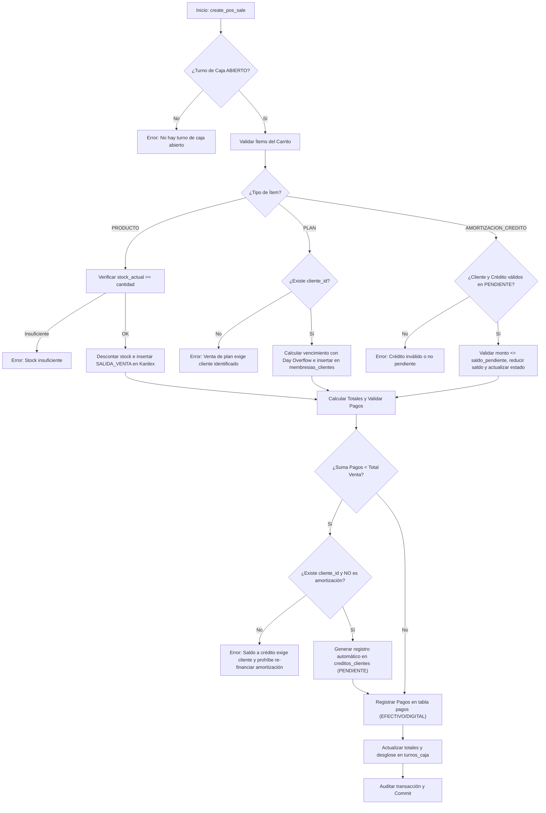

# 📋 CONTRATO TÉCNICO EJECUTABLE: SLICE 4
**Turnos de Caja (Física y Digital), Punto de Venta (POS), Motor de Créditos y "Tachado" en 2 Pasos**

---

## 1. Contexto & Objetivos del Slice 4

El **Slice 4** constituye el núcleo transaccional, operativo y financiero de **ZaramaGYM**. Su objetivo es orquestar la apertura/cierre de turnos de caja, el procesamiento de ventas multidominio en el Punto de Venta (POS), la emisión y cobro de créditos, y un flujo seguro de anulación en dos fases denominado **"Tachado" en 2 Pasos**.

### Principios Rectores de Arquitectura:
1. **Arquitectura de Caja Triple (Física, Digital y Mixta):**
   - **Caja Física (`EFECTIVO`):** Apertura obligatoria con fondo inicial y cierre mediante arqueo manual ciego o asistido de billetes y monedas. El efectivo físico jamás se mezcla con operaciones electrónicas para evitar distorsiones en el arqueo de gaveta.
   - **Caja Digital (Panel Paralelo):** Control segregado para `YAPE`, `PLIN`, `TRANSFERENCIA` y `TARJETA`, con desglose por medio y validación de referencias de operación.
   - **Vista Mixta / Consolidada:** Unificación financiera en dashboards para métricas globales de ingresos y créditos otorgados.
2. **Punto de Venta (POS) Multidominio Unificado:**
   - Un solo carrito de compra permite procesar en una transacción atómica:
     - **Productos:** Validación estricta de stock disponible, descuento inmediato e inserción en el kardex inmutable (`inventario_movimientos` con `tipo_movimiento = 'SALIDA_VENTA'`).
     - **Planes de Membresía / Pases Diarios:** Exigen asociación con un cliente, calculan automáticamente la fecha de vencimiento mediante el algoritmo *Day Overflow* del Slice 3 y registran la vigencia en `membresias_clientes` dejando lista la base para el Semáforo QR del Slice 5.
     - **Amortizaciones de Deuda:** Pago parcial o total de saldos pendientes en `creditos_clientes`, reduciendo la deuda hasta marcarla como `PAGADO`.
3. **Motor de Créditos y Pagos Parciales (`creditos_clientes`):**
   - Si la suma de pagos registrados es inferior al total de la venta (`suma_pagos < total_venta`), el saldo restante se transforma de manera automática en un crédito asociado al cliente (`MEMBRESIA_PAGO_PARCIAL` o `PRODUCTO_CREDITO`).
4. **Flujo de "Tachado" en 2 Pasos (Seguridad y Control Anti-Fraude):**
   - **Paso 1 (`strike_sale`):** Ejecutable en el acto por cualquier operador (`RECEPCIONISTA`, `SUPERVISOR`, `ADMINISTRADOR`) **únicamente mientras el turno de caja de la venta permanezca `ABIERTO`**. Revierte el stock al inventario (`REVERSION_TACHADO`), restaura o anula deudas y membresías, y descuenta el dinero del arqueo del turno en vivo.
   - **Paso 2 (`resolve_struck_sale`):** Bandeja exclusiva del `ADMINISTRADOR` para auditar la operación y dictaminar:
     - `CONFIRMAR_ANULACION`: Cierra la venta como `ANULADA_DEFINITIVA`.
     - `REVERTIR_TACHADO`: Deshace el tachado (solo si el turno sigue abierto), retornando la venta a `COMPLETADA` y descontando el stock nuevamente.
5. **Visibilidad Operativa "Caso Juan Pérez" en el POS:**
   - Todo trabajador o usuario del sistema registrado como cliente (`clientes`) debe poder ser consultado y atendido en caja por cualquier recepcionista de turno, levantando el aislamiento restrictivo en `list_clients` y `get_client` mientras se preserva la protección de sus datos en los módulos maestros de `Personas` y `Usuarios`.

---

## 2. Esquema DDL de `src-tauri/migrations/004_cash_pos_credits.sql`

```sql
-- ============================================================================
-- MIGRACIÓN 004: TURNOS DE CAJA, VENTAS POS, PAGOS, CRÉDITOS Y MEMBRESÍAS
-- Motor: SQLite 3 (WAL Mode, Zero-Delete, Integridad Referencial Estricta)
-- ============================================================================

PRAGMA foreign_keys = ON;

-- 1. TABLA: TURNOS_CAJA (Control de Arqueo Físico y Caja Digital Paralela)
CREATE TABLE IF NOT EXISTS turnos_caja (
    id                              INTEGER PRIMARY KEY AUTOINCREMENT,
    usuario_apertura_id             INTEGER NOT NULL REFERENCES usuarios_sistema(id) ON DELETE RESTRICT,
    usuario_cierre_id               INTEGER REFERENCES usuarios_sistema(id) ON DELETE RESTRICT,
    fecha_apertura                  TEXT NOT NULL DEFAULT (datetime('now', 'localtime')),
    fecha_cierre                    TEXT,
    monto_apertura_fisico           DECIMAL(10,2) NOT NULL DEFAULT 0.00 CHECK(CAST(monto_apertura_fisico AS REAL) >= 0),
    total_ventas_efectivo           DECIMAL(10,2) NOT NULL DEFAULT 0.00,
    total_efectivo_esperado         DECIMAL(10,2) NOT NULL DEFAULT 0.00,
    monto_cierre_fisico_declarado   DECIMAL(10,2),
    diferencia_arqueo_fisico        DECIMAL(10,2),
    total_ventas_digital            DECIMAL(10,2) NOT NULL DEFAULT 0.00,
    desglose_digital_json           TEXT NOT NULL DEFAULT '{"YAPE":"0.00","PLIN":"0.00","TRANSFERENCIA":"0.00","TARJETA":"0.00"}',
    estado                          TEXT NOT NULL DEFAULT 'ABIERTO' CHECK(estado IN ('ABIERTO', 'CERRADO')),
    notas_apertura                  TEXT,
    notas_cierre                    TEXT,
    created_at                      TEXT NOT NULL DEFAULT (datetime('now', 'localtime')),
    updated_at                      TEXT NOT NULL DEFAULT (datetime('now', 'localtime'))
);

CREATE INDEX IF NOT EXISTS idx_turnos_caja_usuario_ap ON turnos_caja(usuario_apertura_id);
CREATE INDEX IF NOT EXISTS idx_turnos_caja_usuario_ci ON turnos_caja(usuario_cierre_id);
CREATE INDEX IF NOT EXISTS idx_turnos_caja_estado ON turnos_caja(estado);
CREATE INDEX IF NOT EXISTS idx_turnos_caja_fecha_ap ON turnos_caja(fecha_apertura DESC);

-- Restricción única parcial: Garantiza a nivel de motor SQLite que jamás existan 2 turnos abiertos simultáneamente
CREATE UNIQUE INDEX IF NOT EXISTS idx_turnos_caja_unico_abierto 
ON turnos_caja(estado) 
WHERE estado = 'ABIERTO';


-- 2. TABLA: VENTAS (Cabecera de Transacciones en Punto de Venta)
CREATE TABLE IF NOT EXISTS ventas (
    id                              INTEGER PRIMARY KEY AUTOINCREMENT,
    turno_caja_id                   INTEGER NOT NULL REFERENCES turnos_caja(id) ON DELETE RESTRICT,
    cliente_id                      INTEGER REFERENCES clientes(id) ON DELETE RESTRICT,
    usuario_vendedor_id             INTEGER NOT NULL REFERENCES usuarios_sistema(id) ON DELETE RESTRICT,
    subtotal                        DECIMAL(10,2) NOT NULL CHECK(CAST(subtotal AS REAL) >= 0),
    descuento                       DECIMAL(10,2) NOT NULL DEFAULT 0.00 CHECK(CAST(descuento AS REAL) >= 0),
    total_venta                     DECIMAL(10,2) NOT NULL CHECK(CAST(total_venta AS REAL) >= 0),
    monto_pagado_efectivo           DECIMAL(10,2) NOT NULL DEFAULT 0.00,
    monto_pagado_digital            DECIMAL(10,2) NOT NULL DEFAULT 0.00,
    saldo_credito_generado          DECIMAL(10,2) NOT NULL DEFAULT 0.00,
    estado_venta                    TEXT NOT NULL DEFAULT 'COMPLETADA' CHECK(estado_venta IN ('COMPLETADA', 'TACHADA_EN_TURNO', 'ANULADA_DEFINITIVA')),
    tachado_por_usuario_id          INTEGER REFERENCES usuarios_sistema(id) ON DELETE RESTRICT,
    fecha_tachado                   TEXT,
    motivo_tachado                  TEXT,
    resuelto_por_admin_id           INTEGER REFERENCES usuarios_sistema(id) ON DELETE RESTRICT,
    fecha_resolucion_tachado        TEXT,
    nota_resolucion_tachado         TEXT,
    notas                           TEXT,
    created_at                      TEXT NOT NULL DEFAULT (datetime('now', 'localtime')),
    updated_at                      TEXT NOT NULL DEFAULT (datetime('now', 'localtime')),
    CHECK (CAST(total_venta AS REAL) = ROUND(CAST(subtotal AS REAL) - CAST(descuento AS REAL), 2))
);

CREATE INDEX IF NOT EXISTS idx_ventas_turno ON ventas(turno_caja_id);
CREATE INDEX IF NOT EXISTS idx_ventas_cliente ON ventas(cliente_id);
CREATE INDEX IF NOT EXISTS idx_ventas_vendedor ON ventas(usuario_vendedor_id);
CREATE INDEX IF NOT EXISTS idx_ventas_estado ON ventas(estado_venta);
CREATE INDEX IF NOT EXISTS idx_ventas_created_at ON ventas(created_at DESC);


-- 3. TABLA: CREDITOS_CLIENTES (Motor Centralizado de Cuentas por Cobrar)
CREATE TABLE IF NOT EXISTS creditos_clientes (
    id                              INTEGER PRIMARY KEY AUTOINCREMENT,
    cliente_id                      INTEGER NOT NULL REFERENCES clientes(id) ON DELETE RESTRICT,
    venta_origen_id                 INTEGER REFERENCES ventas(id) ON DELETE RESTRICT,
    origen_credito                  TEXT NOT NULL CHECK(origen_credito IN (
        'MEMBRESIA_PAGO_PARCIAL',
        'PRODUCTO_CREDITO',
        'PASE_DIARIO_SEMAFORO_ROJO'
    )),
    descripcion                     TEXT NOT NULL,
    monto_total                     DECIMAL(10,2) NOT NULL CHECK(CAST(monto_total AS REAL) > 0),
    monto_pagado                    DECIMAL(10,2) NOT NULL DEFAULT 0.00 CHECK(CAST(monto_pagado AS REAL) >= 0),
    saldo_pendiente                 DECIMAL(10,2) NOT NULL CHECK(CAST(saldo_pendiente AS REAL) >= 0),
    estado                          TEXT NOT NULL DEFAULT 'PENDIENTE' CHECK(estado IN ('PENDIENTE', 'PAGADO', 'ANULADO')),
    registrado_por_usuario_id       INTEGER NOT NULL REFERENCES usuarios_sistema(id) ON DELETE RESTRICT,
    fecha_emision                   TEXT NOT NULL DEFAULT (datetime('now', 'localtime')),
    fecha_ultimo_pago               TEXT,
    notas                           TEXT,
    created_at                      TEXT NOT NULL DEFAULT (datetime('now', 'localtime')),
    updated_at                      TEXT NOT NULL DEFAULT (datetime('now', 'localtime')),
    CHECK (ROUND(CAST(monto_total AS REAL) - CAST(monto_pagado AS REAL), 2) = CAST(saldo_pendiente AS REAL))
);

CREATE INDEX IF NOT EXISTS idx_creditos_cliente ON creditos_clientes(cliente_id);
CREATE INDEX IF NOT EXISTS idx_creditos_venta_origen ON creditos_clientes(venta_origen_id);
CREATE INDEX IF NOT EXISTS idx_creditos_estado ON creditos_clientes(estado);
CREATE INDEX IF NOT EXISTS idx_creditos_origen ON creditos_clientes(origen_credito);


-- 4. TABLA: VENTA_DETALLES (Ítems de Venta Multidominio)
CREATE TABLE IF NOT EXISTS venta_detalles (
    id                              INTEGER PRIMARY KEY AUTOINCREMENT,
    venta_id                        INTEGER NOT NULL REFERENCES ventas(id) ON DELETE RESTRICT,
    tipo_item                       TEXT NOT NULL CHECK(tipo_item IN ('PRODUCTO', 'PLAN', 'AMORTIZACION_CREDITO')),
    producto_id                     INTEGER REFERENCES productos(id) ON DELETE RESTRICT,
    plan_id                         INTEGER REFERENCES planes(id) ON DELETE RESTRICT,
    credito_id                      INTEGER REFERENCES creditos_clientes(id) ON DELETE RESTRICT,
    descripcion                     TEXT NOT NULL,
    cantidad                        INTEGER NOT NULL DEFAULT 1 CHECK(cantidad >= 1),
    precio_unitario                 DECIMAL(10,2) NOT NULL CHECK(CAST(precio_unitario AS REAL) >= 0),
    subtotal                        DECIMAL(10,2) NOT NULL CHECK(CAST(subtotal AS REAL) >= 0),
    fecha_inicio_plan               TEXT,
    fecha_fin_plan                  TEXT,
    created_at                      TEXT NOT NULL DEFAULT (datetime('now', 'localtime')),
    CHECK (
        (tipo_item = 'PRODUCTO' AND producto_id IS NOT NULL AND plan_id IS NULL AND credito_id IS NULL) OR
        (tipo_item = 'PLAN' AND plan_id IS NOT NULL AND producto_id IS NULL AND credito_id IS NULL) OR
        (tipo_item = 'AMORTIZACION_CREDITO' AND credito_id IS NOT NULL AND producto_id IS NULL AND plan_id IS NULL)
    ),
    CHECK (ROUND(CAST(cantidad AS REAL) * CAST(precio_unitario AS REAL), 2) = CAST(subtotal AS REAL))
);

CREATE INDEX IF NOT EXISTS idx_detalles_venta ON venta_detalles(venta_id);
CREATE INDEX IF NOT EXISTS idx_detalles_producto ON venta_detalles(producto_id);
CREATE INDEX IF NOT EXISTS idx_detalles_plan ON venta_detalles(plan_id);
CREATE INDEX IF NOT EXISTS idx_detalles_credito ON venta_detalles(credito_id);


-- 5. TABLA: PAGOS (Desglose Atómico de Medios de Pago por Venta)
CREATE TABLE IF NOT EXISTS pagos (
    id                              INTEGER PRIMARY KEY AUTOINCREMENT,
    venta_id                        INTEGER NOT NULL REFERENCES ventas(id) ON DELETE RESTRICT,
    turno_caja_id                   INTEGER NOT NULL REFERENCES turnos_caja(id) ON DELETE RESTRICT,
    metodo_pago                     TEXT NOT NULL CHECK(metodo_pago IN ('EFECTIVO', 'YAPE', 'PLIN', 'TRANSFERENCIA', 'TARJETA')),
    canal_caja                      TEXT NOT NULL CHECK(canal_caja IN ('FISICA', 'DIGITAL')),
    monto                           DECIMAL(10,2) NOT NULL CHECK(CAST(monto AS REAL) > 0),
    referencia_operacion            TEXT,
    estado_pago                     TEXT NOT NULL DEFAULT 'ACTIVO' CHECK(estado_pago IN ('ACTIVO', 'REVERTIDO')),
    created_at                      TEXT NOT NULL DEFAULT (datetime('now', 'localtime')),
    CHECK (
        (metodo_pago = 'EFECTIVO' AND canal_caja = 'FISICA') OR
        (metodo_pago IN ('YAPE', 'PLIN', 'TRANSFERENCIA', 'TARJETA') AND canal_caja = 'DIGITAL')
    )
);

CREATE INDEX IF NOT EXISTS idx_pagos_venta ON pagos(venta_id);
CREATE INDEX IF NOT EXISTS idx_pagos_turno ON pagos(turno_caja_id);
CREATE INDEX IF NOT EXISTS idx_pagos_metodo ON pagos(metodo_pago);
CREATE INDEX IF NOT EXISTS idx_pagos_estado ON pagos(estado_pago);


-- 6. TABLA: MEMBRESIAS_CLIENTES (Vínculo Operativo POS - Membresías Activas para Asistencias)
CREATE TABLE IF NOT EXISTS membresias_clientes (
    id                              INTEGER PRIMARY KEY AUTOINCREMENT,
    cliente_id                      INTEGER NOT NULL REFERENCES clientes(id) ON DELETE RESTRICT,
    plan_id                         INTEGER NOT NULL REFERENCES planes(id) ON DELETE RESTRICT,
    venta_id                        INTEGER REFERENCES ventas(id) ON DELETE RESTRICT,
    fecha_inicio                    TEXT NOT NULL,
    fecha_vencimiento               TEXT NOT NULL,
    precio_pactado                  DECIMAL(10,2) NOT NULL CHECK(CAST(precio_pactado AS REAL) >= 0),
    estado                          TEXT NOT NULL DEFAULT 'ACTIVA' CHECK(estado IN ('ACTIVA', 'VENCIDA', 'ANULADA')),
    registrado_por_usuario_id       INTEGER NOT NULL REFERENCES usuarios_sistema(id) ON DELETE RESTRICT,
    created_at                      TEXT NOT NULL DEFAULT (datetime('now', 'localtime')),
    updated_at                      TEXT NOT NULL DEFAULT (datetime('now', 'localtime'))
);

CREATE INDEX IF NOT EXISTS idx_membresias_cliente ON membresias_clientes(cliente_id);
CREATE INDEX IF NOT EXISTS idx_membresias_plan ON membresias_clientes(plan_id);
CREATE INDEX IF NOT EXISTS idx_membresias_venta ON membresias_clientes(venta_id);
CREATE INDEX IF NOT EXISTS idx_membresias_estado ON membresias_clientes(estado);
CREATE INDEX IF NOT EXISTS idx_membresias_vencimiento ON membresias_clientes(fecha_vencimiento);
```

---

## 3. Reglas de Negocio Transaccionales & Flujos de Operación

### 3.1 Arquitectura de Caja Triple (`FISICA`, `DIGITAL`, `MIXTA`)
1. **Invarianza del Arqueo de Caja Física:**
   - Todo ingreso en `EFECTIVO` alimenta exclusivamente el arqueo físico.
   - Fórmula matemática de efectivo esperado en caja:
     $$\text{total\_efectivo\_esperado} = \text{monto\_apertura\_fisico} + \sum \text{pagos\_activos}(\text{EFECTIVO})$$
2. **Aislamiento del Panel Digital:**
   - Medios admitidos: `YAPE`, `PLIN`, `TRANSFERENCIA`, `TARJETA`.
   - Canal estricto: `DIGITAL`.
   - Se totalizan en `total_ventas_digital` y se desglosan en el objeto JSON reactivo:
     ```json
     {
       "YAPE": "145.00",
       "PLIN": "30.00",
       "TRANSFERENCIA": "80.00",
       "TARJETA": "210.00"
     }
     ```
   - Ningún céntimo electrónico afecta el saldo en billetes ni la gaveta física.
3. **Cierre de Turno (`close_cash_shift`):**
   - El operador declara el monto físico en mano (`monto_cierre_fisico_declarado`).
   - El sistema calcula y persiste de forma inmutable:
     $$\text{diferencia\_arqueo\_fisico} = \text{monto\_cierre\_fisico\_declarado} - \text{total\_efectivo\_esperado}$$
     - $\text{diferencia} = 0.00$: Cuadre exacto.
     - $\text{diferencia} < 0.00$: Faltante de dinero en efectivo.
     - $\text{diferencia} > 0.00$: Sobrante de dinero en efectivo.
   - El turno pasa a estado `'CERRADO'` liberando el índice parcial para permitir una apertura posterior.

---

### 3.2 Carrito POS Multidominio (`create_pos_sale`)

Toda operación de venta se procesa en una sola transacción (`BEGIN IMMEDIATE`):



#### Reglas Específicas por Dominio:
1. **Ítem Producto:**
   - Verifica `stock_actual >= cantidad`.
   - Actualiza `productos.stock_actual = stock_actual - cantidad`.
   - Inserta fila en `inventario_movimientos`:
     - `tipo_movimiento = 'SALIDA_VENTA'`
     - `signo = '-'`
     - `motivo_justificacion = format!("Venta POS #{} al público/cliente", venta_id)`
2. **Ítem Plan:**
   - Exige `cliente_id IS NOT NULL`.
   - Consulta el plan en `planes`.
   - Aplica `calcular_fecha_vencimiento` (Slice 3). Si `duracion_meses == 0`, vence a las `23:59:59` del mismo día; si $\ge 1$ mes, proyecta con desbordamiento de fin de mes (*Day Overflow*).
   - Inserta en `membresias_clientes` con `estado = 'ACTIVA'`.
3. **Ítem Amortización de Crédito:**
   - Exige `cliente_id` y `credito_id`.
   - Busca el crédito; valida que pertenezca al cliente y `estado == 'PENDIENTE'`.
   - Valida que `monto_amortizar <= saldo_pendiente`.
   - Reduce `saldo_pendiente -= monto_amortizar`, incrementa `monto_pagado += monto_amortizar` y actualiza `fecha_ultimo_pago`.
   - Si `saldo_pendiente == 0.00`, marca `estado = 'PAGADO'`.
   - **Regla estricta:** La venta que amortiza deudas debe pagarse al 100% de contado o medios digitales (`suma_pagos >= total_venta`). No se admite diferir o generar un nuevo crédito a partir de una amortización.
4. **Pagos Mixtos y Generación de Crédito:**
   - La suma de pagos $\text{suma\_pagos} = \text{monto\_pagado\_efectivo} + \text{monto\_pagado\_digital}$.
   - Si $\text{suma\_pagos} > \text{total\_venta}$:
     - En efectivo: se calcula el vuelto $\text{vuelto} = \text{monto\_efectivo} - (\text{total\_venta} - \text{monto\_digital})$. En la tabla `pagos` se asienta únicamente el efectivo neto retenido por el gimnasio para preservar la cuadratura exacta del arqueo físico.
     - En digital: no se permite registrar un monto digital superior al total a cobrar (rechaza con `AppError::Validation`).
   - Si $\text{suma\_pagos} < \text{total\_venta}$:
     - Exige obligatoriamente `cliente_id`.
     - $\text{saldo\_credito} = \text{total\_venta} - \text{suma\_pagos}$.
     - Se clasifica `origen_credito`:
       - Si el carrito contiene algún ítem `PLAN` $\rightarrow$ `'MEMBRESIA_PAGO_PARCIAL'`.
       - Si solo contiene ítems `PRODUCTO` $\rightarrow$ `'PRODUCTO_CREDITO'`.
     - Crea la fila en `creditos_clientes`: `monto_total = total_venta`, `monto_pagado = suma_pagos`, `saldo_pendiente = saldo_credito`, `estado = 'PENDIENTE'`.

---

### 3.3 Flujo de "Tachado" en 2 Pasos

El sistema rechaza anulaciones arbitrarias o eliminaciones destructivas. En su lugar, implementa el flujo de tachado en dos fases:

```
[Venta Completada]
       │
       ▼ (Paso 1: strike_sale - Solo si Turno de Caja está ABIERTO)
[TACHADA_EN_TURNO]
 ├── Revierte efectivo y digital del turno inmediatamente
 ├── Revierte stock a inventario ('REVERSION_TACHADO')
 └── Anula membresía o anula crédito generado
       │
       ├────────────────────────────────────────┐
       ▼ (Paso 2A: resolve_struck_sale)         ▼ (Paso 2B: resolve_struck_sale)
 [ANULADA_DEFINITIVA]                     [COMPLETADA (Reactivada)]
  (Confirmación Admin - Turno Abierto/Cerrado)   (Reversión Admin - Solo si Turno sigue Abierto)
```

#### Paso 1: Tachado en Turno Abierto (`strike_sale`)
- **Operadores autorizados:** `RECEPCIONISTA`, `SUPERVISOR`, `ADMINISTRADOR`.
- **Condiciones obligatorias:**
  1. El turno de caja `turno_caja_id` debe estar en estado `'ABIERTO'`. Si el turno ya se cerró, la operación es **rechazada tajantemente** (`AppError::Validation("No se puede tachar una venta de un turno ya cerrado")`).
  2. `estado_venta` debe ser `'COMPLETADA'`.
  3. `motivo_tachado.trim().len() >= 5`.
  4. Si la venta originó un crédito y dicho crédito ya recibió amortizaciones en ventas posteriores completadas, la operación es rechazada con `AppError::Conflict("No se puede tachar la venta original mientras existan amortizaciones posteriores no tachadas")`.
- **Efectos atómicos de la transacción en Paso 1:**
  1. `ventas.estado_venta = 'TACHADA_EN_TURNO'`, `tachado_por_usuario_id = session.user_id`, `fecha_tachado = now()`, `motivo_tachado = motivo`.
  2. Por cada fila en `pagos`: `estado_pago = 'REVERTIDO'`.
  3. Descuenta de `turnos_caja` abierto:
     - `total_ventas_efectivo -= venta.monto_pagado_efectivo`
     - `total_efectivo_esperado -= venta.monto_pagado_efectivo`
     - `total_ventas_digital -= venta.monto_pagado_digital`
     - Recalcula y descuenta en `desglose_digital_json`.
  4. Por cada ítem `PRODUCTO`:
     - Devuelve stock: `productos.stock_actual += detalle.cantidad`.
     - Inserta en `inventario_movimientos`: `tipo_movimiento = 'REVERSION_TACHADO'`, `signo = '+'`, `cantidad = detalle.cantidad`, `motivo_justificacion = format!("Reversión por tachado de Venta #{}", venta_id)`.
  5. Si originó membresía en `membresias_clientes`: `estado = 'ANULADA'`.
  6. Si originó crédito en `creditos_clientes`: `estado = 'ANULADO'`, `saldo_pendiente = 0.00`.
  7. Si fue `AMORTIZACION_CREDITO`: Restaura el crédito previo (`saldo_pendiente += subtotal`, `monto_pagado -= subtotal`, `estado = 'PENDIENTE'`).
  8. Audita en `auditoria_logs`: `modulo = 'CAJA_POS'`, `accion = 'VENTA_TACHADA'`.

#### Paso 2: Resolución Definitiva en Bandeja Administrador (`resolve_struck_sale`)
- **Operador autorizado:** Exclusivo `ADMINISTRADOR` (Cualquier otro rol recibe `AppError::Forbidden`).
- Recibe `venta_id`, `accion: 'CONFIRMAR_ANULACION' | 'REVERTIR_TACHADO'`, `nota_resolucion`.
- Exige `ventas.estado_venta == 'TACHADA_EN_TURNO'`.
- **Acción `'CONFIRMAR_ANULACION'`:**
  - Puede ejecutarse con el turno abierto o cerrado (el dinero y el stock ya fueron compensados en el Paso 1).
  - Pasa `ventas.estado_venta = 'ANULADA_DEFINITIVA'`.
  - Registra `resuelto_por_admin_id`, `fecha_resolucion_tachado = now()` y nota.
  - Audita `VENTA_ANULACION_CONFIRMADA`.
- **Acción `'REVERTIR_TACHADO'` (Deshacer error operativo):**
  - Exige obligatoriamente que el turno de caja siga `'ABIERTO'`. Si está cerrado, rechaza con `AppError::Validation("No es posible revertir un tachado si el turno de caja ya fue cerrado")`.
  - Verifica disponibilidad de stock actual para los productos de la venta.
  - Vuelve `ventas.estado_venta = 'COMPLETADA'`.
  - Restaura `pagos.estado_pago = 'ACTIVO'`.
  - Vuelve a sumar al turno abierto el efectivo y los medios digitales.
  - Descuenta el stock en `productos` e inserta movimiento `SALIDA_VENTA`.
  - Reactiva membresía (`ACTIVA`) o crédito (`PENDIENTE`).
  - Audita `VENTA_TACHADO_REVERTIDO`.

---

### 3.4 Regla Operativa "Caso Juan Pérez" en el POS

Para posibilitar que cualquier recepcionista cobre o inscriba planes a supervisores o administradores que entrenan en el gimnasio:
1. Las consultas `list_clients` y `get_client` en `entity_service.rs` se ajustan para **retornar la totalidad de registros activos de la tabla `clientes`**, independientemente del rol de usuario (`u.rol_principal`) asociado a su persona base.
2. Los módulos maestros de `Personas` y `Usuarios` retienen su aislamiento RBAC estricto: el recepcionista no puede ver ni modificar contraseñas, roles, fotos ni datos personales de Juan Pérez en la pantalla de gestión administrativa, pero en el **Punto de Venta (POS)** y en la **Bandeja de Deudores** sí puede buscar a Juan Pérez por DNI o apellidos para cobrarle su mensualidad o registrar sus consumos.

---

## 4. Contratos Tipados Rust (`src-tauri/src/models/pos.rs`)

```rust
use rust_decimal::Decimal;
use serde::{Deserialize, Serialize};

// ============================================================================
// ENUMS DE DOMINIO POS, TURNOS Y CRÉDITOS
// ============================================================================

#[derive(Debug, Clone, Copy, PartialEq, Eq, Serialize, Deserialize)]
#[serde(rename_all = "SCREAMING_SNAKE_CASE")]
pub enum CashShiftState {
    Abierto,
    Cerrado,
}

#[derive(Debug, Clone, Copy, PartialEq, Eq, Serialize, Deserialize)]
#[serde(rename_all = "SCREAMING_SNAKE_CASE")]
pub enum SaleState {
    Completada,
    TachadaEnTurno,
    AnuladaDefinitiva,
}

#[derive(Debug, Clone, Copy, PartialEq, Eq, Serialize, Deserialize)]
#[serde(rename_all = "SCREAMING_SNAKE_CASE")]
pub enum PaymentMethod {
    Efectivo,
    Yape,
    Plin,
    Transferencia,
    Tarjeta,
}

#[derive(Debug, Clone, Copy, PartialEq, Eq, Serialize, Deserialize)]
#[serde(rename_all = "SCREAMING_SNAKE_CASE")]
pub enum PaymentChannel {
    Fisica,
    Digital,
}

#[derive(Debug, Clone, Copy, PartialEq, Eq, Serialize, Deserialize)]
#[serde(rename_all = "SCREAMING_SNAKE_CASE")]
pub enum PaymentState {
    Activo,
    Revertido,
}

#[derive(Debug, Clone, Copy, PartialEq, Eq, Serialize, Deserialize)]
#[serde(rename_all = "SCREAMING_SNAKE_CASE")]
pub enum PosItemType {
    Producto,
    Plan,
    AmortizacionCredito,
}

#[derive(Debug, Clone, Copy, PartialEq, Eq, Serialize, Deserialize)]
#[serde(rename_all = "SCREAMING_SNAKE_CASE")]
pub enum CreditOrigin {
    MembresiaPagoParcial,
    ProductoCredito,
    PaseDiarioSemaforoRojo,
}

#[derive(Debug, Clone, Copy, PartialEq, Eq, Serialize, Deserialize)]
#[serde(rename_all = "SCREAMING_SNAKE_CASE")]
pub enum CreditState {
    Pendiente,
    Pagado,
    Anulado,
}

#[derive(Debug, Clone, Copy, PartialEq, Eq, Serialize, Deserialize)]
#[serde(rename_all = "SCREAMING_SNAKE_CASE")]
pub enum ClientMembershipState {
    Activa,
    Vencida,
    Anulada,
}

#[derive(Debug, Clone, Copy, PartialEq, Eq, Serialize, Deserialize)]
#[serde(rename_all = "SCREAMING_SNAKE_CASE")]
pub enum ResolveStruckAction {
    ConfirmarAnulacion,
    RevertirTachado,
}

// ============================================================================
// DTOs Y MODELOS DE TURNOS DE CAJA
// ============================================================================

#[derive(Debug, Clone, Serialize, Deserialize)]
pub struct DigitalBreakdownDto {
    pub yape: Decimal,
    pub plin: Decimal,
    pub transferencia: Decimal,
    pub tarjeta: Decimal,
}

impl Default for DigitalBreakdownDto {
    fn default() -> Self {
        Self {
            yape: Decimal::ZERO,
            plin: Decimal::ZERO,
            transferencia: Decimal::ZERO,
            tarjeta: Decimal::ZERO,
        }
    }
}

#[derive(Debug, Clone, Serialize, Deserialize)]
pub struct CashShiftDto {
    pub id: i64,
    pub usuario_apertura_id: i64,
    pub usuario_apertura_username: String,
    pub usuario_cierre_id: Option<i64>,
    pub usuario_cierre_username: Option<String>,
    pub fecha_apertura: String,
    pub fecha_cierre: Option<String>,
    pub monto_apertura_fisico: Decimal,
    pub total_ventas_efectivo: Decimal,
    pub total_efectivo_esperado: Decimal,
    pub monto_cierre_fisico_declarado: Option<Decimal>,
    pub diferencia_arqueo_fisico: Option<Decimal>,
    pub total_ventas_digital: Decimal,
    pub desglose_digital: DigitalBreakdownDto,
    pub estado: CashShiftState,
    pub notas_apertura: Option<String>,
    pub notas_cierre: Option<String>,
    pub created_at: String,
    pub updated_at: String,
}

#[derive(Debug, Clone, Serialize, Deserialize)]
pub struct CashShiftSummaryDto {
    pub shift: CashShiftDto,
    pub cantidad_ventas_completadas: i64,
    pub cantidad_ventas_tachadas: i64,
    pub total_creditos_emitidos: Decimal,
    pub total_consolidado_recaudado: Decimal, // efectivo + digital
}

#[derive(Debug, Deserialize)]
pub struct OpenCashShiftInput {
    pub monto_apertura_fisico: Decimal,
    pub notas_apertura: Option<String>,
}

#[derive(Debug, Deserialize)]
pub struct CloseCashShiftInput {
    pub monto_cierre_fisico_declarado: Decimal,
    pub notas_cierre: Option<String>,
}

#[derive(Debug, Deserialize, Default)]
pub struct CashShiftFilter {
    pub estado: Option<CashShiftState>,
    pub fecha_desde: Option<String>,
    pub fecha_hasta: Option<String>,
    pub limit: Option<i64>,
    pub offset: Option<i64>,
}

// ============================================================================
// DTOs Y MODELOS DE PUNTO DE VENTA (POS)
// ============================================================================

#[derive(Debug, Deserialize)]
pub struct PosSaleItemInput {
    pub tipo_item: PosItemType,
    pub producto_id: Option<i64>,
    pub plan_id: Option<i64>,
    pub credito_id: Option<i64>,
    pub cantidad: i64,
    pub precio_unitario: Decimal,
    pub subtotal: Decimal,
    pub fecha_inicio_plan: Option<String>, // Para membresías
}

#[derive(Debug, Deserialize)]
pub struct PosPaymentInput {
    pub metodo_pago: PaymentMethod,
    pub monto: Decimal,
    pub referencia_operacion: Option<String>,
}

#[derive(Debug, Deserialize)]
pub struct CreatePosSaleInput {
    pub cliente_id: Option<i64>,
    pub items: Vec<PosSaleItemInput>,
    pub descuento: Option<Decimal>,
    pub pagos: Vec<PosPaymentInput>,
    pub notas: Option<String>,
}

#[derive(Debug, Clone, Serialize, Deserialize)]
pub struct SaleItemDetailDto {
    pub id: i64,
    pub tipo_item: PosItemType,
    pub producto_id: Option<i64>,
    pub producto_sku: Option<String>,
    pub plan_id: Option<i64>,
    pub plan_codigo: Option<String>,
    pub credito_id: Option<i64>,
    pub descripcion: String,
    pub cantidad: i64,
    pub precio_unitario: Decimal,
    pub subtotal: Decimal,
    pub fecha_inicio_plan: Option<String>,
    pub fecha_fin_plan: Option<String>,
}

#[derive(Debug, Clone, Serialize, Deserialize)]
pub struct PaymentDetailDto {
    pub id: i64,
    pub metodo_pago: PaymentMethod,
    pub canal_caja: PaymentChannel,
    pub monto: Decimal,
    pub referencia_operacion: Option<String>,
    pub estado_pago: PaymentState,
    pub created_at: String,
}

#[derive(Debug, Clone, Serialize, Deserialize)]
pub struct SaleDetailDto {
    pub id: i64,
    pub turno_caja_id: i64,
    pub cliente_id: Option<i64>,
    pub cliente_nombre_completo: Option<String>,
    pub cliente_numero_documento: Option<String>,
    pub usuario_vendedor_id: i64,
    pub usuario_vendedor_username: String,
    pub subtotal: Decimal,
    pub descuento: Decimal,
    pub total_venta: Decimal,
    pub monto_pagado_efectivo: Decimal,
    pub monto_pagado_digital: Decimal,
    pub saldo_credito_generado: Decimal,
    pub estado_venta: SaleState,
    pub tachado_por_usuario_id: Option<i64>,
    pub tachado_por_username: Option<String>,
    pub fecha_tachado: Option<String>,
    pub motivo_tachado: Option<String>,
    pub resuelto_por_admin_id: Option<i64>,
    pub resuelto_por_admin_username: Option<String>,
    pub fecha_resolucion_tachado: Option<String>,
    pub nota_resolucion_tachado: Option<String>,
    pub notas: Option<String>,
    pub created_at: String,
    pub items: Vec<SaleItemDetailDto>,
    pub pagos: Vec<PaymentDetailDto>,
}

#[derive(Debug, Clone, Serialize, Deserialize)]
pub struct SaleListItemDto {
    pub id: i64,
    pub turno_caja_id: i64,
    pub cliente_nombre_completo: Option<String>,
    pub total_venta: Decimal,
    pub monto_pagado_efectivo: Decimal,
    pub monto_pagado_digital: Decimal,
    pub saldo_credito_generado: Decimal,
    pub estado_venta: SaleState,
    pub usuario_vendedor_username: String,
    pub created_at: String,
}

#[derive(Debug, Deserialize, Default)]
pub struct SaleFilter {
    pub turno_caja_id: Option<i64>,
    pub cliente_id: Option<i64>,
    pub estado_venta: Option<SaleState>,
    pub fecha_desde: Option<String>,
    pub fecha_hasta: Option<String>,
    pub limit: Option<i64>,
    pub offset: Option<i64>,
}

#[derive(Debug, Deserialize)]
pub struct StrikeSaleInput {
    pub motivo_tachado: String,
}

#[derive(Debug, Deserialize)]
pub struct ResolveStruckSaleInput {
    pub accion: ResolveStruckAction,
    pub nota_resolucion: Option<String>,
}

// ============================================================================
// DTOs Y MODELOS DE CRÉDITOS Y MEMBRESÍAS
// ============================================================================

#[derive(Debug, Clone, Serialize, Deserialize)]
pub struct ClientCreditDto {
    pub id: i64,
    pub cliente_id: i64,
    pub cliente_nombre_completo: String,
    pub cliente_numero_documento: String,
    pub cliente_telefono: Option<String>,
    pub venta_origen_id: Option<i64>,
    pub origen_credito: CreditOrigin,
    pub descripcion: String,
    pub monto_total: Decimal,
    pub monto_pagado: Decimal,
    pub saldo_pendiente: Decimal,
    pub estado: CreditState,
    pub registrado_por_usuario_id: i64,
    pub registrado_por_username: String,
    pub fecha_emision: String,
    pub fecha_ultimo_pago: Option<String>,
    pub notas: Option<String>,
    pub created_at: String,
}

#[derive(Debug, Deserialize, Default)]
pub struct ClientCreditFilter {
    pub cliente_id: Option<i64>,
    pub estado: Option<CreditState>,
    pub origen_credito: Option<CreditOrigin>,
    pub solo_con_deuda: Option<bool>,
    pub limit: Option<i64>,
    pub offset: Option<i64>,
}

#[derive(Debug, Clone, Serialize, Deserialize)]
pub struct ClientMembershipDto {
    pub id: i64,
    pub cliente_id: i64,
    pub cliente_nombre_completo: String,
    pub plan_id: i64,
    pub plan_nombre: String,
    pub venta_id: Option<i64>,
    pub fecha_inicio: String,
    pub fecha_vencimiento: String,
    pub precio_pactado: Decimal,
    pub estado: ClientMembershipState,
    pub dias_restantes: i64,
    pub registrado_por_usuario_id: i64,
    pub registrado_por_username: String,
    pub created_at: String,
}

#[derive(Debug, Deserialize, Default)]
pub struct ClientMembershipFilter {
    pub cliente_id: Option<i64>,
    pub plan_id: Option<i64>,
    pub estado: Option<ClientMembershipState>,
    pub solo_activas: Option<bool>,
    pub limit: Option<i64>,
    pub offset: Option<i64>,
}
```

---

## 5. Contrato de Comandos IPC (`pos_commands.rs`)

| # | Comando IPC | Parámetros | Retorno | RBAC Guard | Auditoría Log |
|---|---|---|---|---|---|
| **1** | `get_active_cash_shift` | *(ninguno)* | `Result<Option<CashShiftDto>, AppError>` | Todos (`RECEPCIONISTA`, `SUPERVISOR`, `ADMINISTRADOR`) | Cero (Sin ruido) |
| **2** | `open_cash_shift` | `input: OpenCashShiftInput` | `Result<CashShiftDto, AppError>` | Todos (`RECEPCIONISTA`, `SUPERVISOR`, `ADMINISTRADOR`) | `CASH_SHIFT_OPENED` (`< 200 B`) |
| **3** | `close_cash_shift` | `input: CloseCashShiftInput` | `Result<CashShiftDto, AppError>` | Todos (`RECEPCIONISTA`, `SUPERVISOR`, `ADMINISTRADOR`) | `CASH_SHIFT_CLOSED` (`< 200 B`) |
| **4** | `list_cash_shifts` | `filter: Option<CashShiftFilter>` | `Result<Vec<CashShiftDto>, AppError>` | `require_supervisor_or_admin` | Cero (Sin ruido) |
| **5** | `get_cash_shift_summary` | `shift_id: Option<i64>` | `Result<CashShiftSummaryDto, AppError>` | Todos (`RECEPCIONISTA`, `SUPERVISOR`, `ADMINISTRADOR`) | Cero (Sin ruido) |
| **6** | `create_pos_sale` | `input: CreatePosSaleInput` | `Result<SaleDetailDto, AppError>` | Todos (`RECEPCIONISTA`, `SUPERVISOR`, `ADMINISTRADOR`) | `POS_SALE_CREATED` (`< 200 B`) |
| **7** | `list_sales` | `filter: Option<SaleFilter>` | `Result<Vec<SaleListItemDto>, AppError>` | Todos (`RECEPCIONISTA`, `SUPERVISOR`, `ADMINISTRADOR`) | Cero (Sin ruido) |
| **8** | `get_sale_detail` | `sale_id: i64` | `Result<SaleDetailDto, AppError>` | Todos (`RECEPCIONISTA`, `SUPERVISOR`, `ADMINISTRADOR`) | Cero (Sin ruido) |
| **9** | `strike_sale` | `sale_id: i64, input: StrikeSaleInput` | `Result<SaleDetailDto, AppError>` | Todos (`RECEPCIONISTA`, `SUPERVISOR`, `ADMINISTRADOR`) | `POS_SALE_STRUCK` (`< 200 B`) |
| **10** | `resolve_struck_sale` | `sale_id: i64, input: ResolveStruckSaleInput` | `Result<SaleDetailDto, AppError>` | Exclusivo `require_admin` | `POS_SALE_STRUCK_RESOLVED` (`< 200 B`) |
| **11** | `list_client_credits` | `filter: Option<ClientCreditFilter>` | `Result<Vec<ClientCreditDto>, AppError>` | Todos (`RECEPCIONISTA`, `SUPERVISOR`, `ADMINISTRADOR`) | Cero (Sin ruido) |
| **12** | `list_client_memberships` | `filter: Option<ClientMembershipFilter>` | `Result<Vec<ClientMembershipDto>, AppError>` | Todos (`RECEPCIONISTA`, `SUPERVISOR`, `ADMINISTRADOR`) | Cero (Sin ruido) |

---

## 6. Tipos e Interfaces TypeScript (`src/types/pos.ts`)

```typescript
// ============================================================================
// ENUMS Y TIPOS BASE DE POS Y TURNOS
// ============================================================================

export type CashShiftState = 'ABIERTO' | 'CERRADO';
export type SaleState = 'COMPLETADA' | 'TACHADA_EN_TURNO' | 'ANULADA_DEFINITIVA';
export type PaymentMethod = 'EFECTIVO' | 'YAPE' | 'PLIN' | 'TRANSFERENCIA' | 'TARJETA';
export type PaymentChannel = 'FISICA' | 'DIGITAL';
export type PaymentState = 'ACTIVO' | 'REVERTIDO';
export type PosItemType = 'PRODUCTO' | 'PLAN' | 'AMORTIZACION_CREDITO';
export type CreditOrigin = 'MEMBRESIA_PAGO_PARCIAL' | 'PRODUCTO_CREDITO' | 'PASE_DIARIO_SEMAFORO_ROJO';
export type CreditState = 'PENDIENTE' | 'PAGADO' | 'ANULADO';
export type ClientMembershipState = 'ACTIVA' | 'VENCIDA' | 'ANULADA';
export type ResolveStruckAction = 'CONFIRMAR_ANULACION' | 'REVERTIR_TACHADO';

// ============================================================================
// TURNOS DE CAJA
// ============================================================================

export interface DigitalBreakdownDto {
  yape: string;
  plin: string;
  transferencia: string;
  tarjeta: string;
}

export interface CashShiftDto {
  id: number;
  usuario_apertura_id: number;
  usuario_apertura_username: string;
  usuario_cierre_id: number | null;
  usuario_cierre_username: string | null;
  fecha_apertura: string;
  fecha_cierre: string | null;
  monto_apertura_fisico: string;
  total_ventas_efectivo: string;
  total_efectivo_esperado: string;
  monto_cierre_fisico_declarado: string | null;
  diferencia_arqueo_fisico: string | null;
  total_ventas_digital: string;
  desglose_digital: DigitalBreakdownDto;
  estado: CashShiftState;
  notas_apertura: string | null;
  notas_cierre: string | null;
  created_at: string;
  updated_at: string;
}

export interface CashShiftSummaryDto {
  shift: CashShiftDto;
  cantidad_ventas_completadas: number;
  cantidad_ventas_tachadas: number;
  total_creditos_emitidos: string;
  total_consolidado_recaudado: string;
}

export interface OpenCashShiftInput {
  monto_apertura_fisico: string;
  notas_apertura?: string;
}

export interface CloseCashShiftInput {
  monto_cierre_fisico_declarado: string;
  notas_cierre?: string;
}

export interface CashShiftFilter {
  estado?: CashShiftState;
  fecha_desde?: string;
  fecha_hasta?: string;
  limit?: number;
  offset?: number;
}

// ============================================================================
// CARRITO POS Y VENTAS
// ============================================================================

export interface PosSaleItemInput {
  tipo_item: PosItemType;
  producto_id?: number;
  plan_id?: number;
  credito_id?: number;
  cantidad: number;
  precio_unitario: string;
  subtotal: string;
  fecha_inicio_plan?: string;
}

export interface PosPaymentInput {
  metodo_pago: PaymentMethod;
  monto: string;
  referencia_operacion?: string;
}

export interface CreatePosSaleInput {
  cliente_id?: number | null;
  items: PosSaleItemInput[];
  descuento?: string;
  pagos: PosPaymentInput[];
  notas?: string;
}

export interface SaleItemDetailDto {
  id: number;
  tipo_item: PosItemType;
  producto_id: number | null;
  producto_sku: string | null;
  plan_id: number | null;
  plan_codigo: string | null;
  credito_id: number | null;
  descripcion: string;
  cantidad: number;
  precio_unitario: string;
  subtotal: string;
  fecha_inicio_plan: string | null;
  fecha_fin_plan: string | null;
}

export interface PaymentDetailDto {
  id: number;
  metodo_pago: PaymentMethod;
  canal_caja: PaymentChannel;
  monto: string;
  referencia_operacion: string | null;
  estado_pago: PaymentState;
  created_at: string;
}

export interface SaleDetailDto {
  id: number;
  turno_caja_id: number;
  cliente_id: number | null;
  cliente_nombre_completo: string | null;
  cliente_numero_documento: string | null;
  usuario_vendedor_id: number;
  usuario_vendedor_username: string;
  subtotal: string;
  descuento: string;
  total_venta: string;
  monto_pagado_efectivo: string;
  monto_pagado_digital: string;
  saldo_credito_generado: string;
  estado_venta: SaleState;
  tachado_por_usuario_id: number | null;
  tachado_por_username: string | null;
  fecha_tachado: string | null;
  motivo_tachado: string | null;
  resuelto_por_admin_id: number | null;
  resuelto_por_admin_username: string | null;
  fecha_resolucion_tachado: string | null;
  nota_resolucion_tachado: string | null;
  notas: string | null;
  created_at: string;
  items: SaleItemDetailDto[];
  pagos: PaymentDetailDto[];
}

export interface SaleListItemDto {
  id: number;
  turno_caja_id: number;
  cliente_nombre_completo: string | null;
  total_venta: string;
  monto_pagado_efectivo: string;
  monto_pagado_digital: string;
  saldo_credito_generado: string;
  estado_venta: SaleState;
  usuario_vendedor_username: string;
  created_at: string;
}

export interface SaleFilter {
  turno_caja_id?: number;
  cliente_id?: number;
  estado_venta?: SaleState;
  fecha_desde?: string;
  fecha_hasta?: string;
  limit?: number;
  offset?: number;
}

export interface StrikeSaleInput {
  motivo_tachado: string;
}

export interface ResolveStruckSaleInput {
  accion: ResolveStruckAction;
  nota_resolucion?: string;
}

// ============================================================================
// CRÉDITOS Y MEMBRESÍAS
// ============================================================================

export interface ClientCreditDto {
  id: number;
  cliente_id: number;
  cliente_nombre_completo: string;
  cliente_numero_documento: string;
  cliente_telefono: string | null;
  venta_origen_id: number | null;
  origen_credito: CreditOrigin;
  descripcion: string;
  monto_total: string;
  monto_pagado: string;
  saldo_pendiente: string;
  estado: CreditState;
  registrado_por_usuario_id: number;
  registrado_por_username: string;
  fecha_emision: string;
  fecha_ultimo_pago: string | null;
  notas: string | null;
  created_at: string;
}

export interface ClientCreditFilter {
  cliente_id?: number;
  estado?: CreditState;
  origen_credito?: CreditOrigin;
  solo_con_deuda?: boolean;
  limit?: number;
  offset?: number;
}

export interface ClientMembershipDto {
  id: number;
  cliente_id: number;
  cliente_nombre_completo: string;
  plan_id: number;
  plan_nombre: string;
  venta_id: number | null;
  fecha_inicio: string;
  fecha_vencimiento: string;
  precio_pactado: string;
  estado: ClientMembershipState;
  dias_restantes: number;
  registrado_por_usuario_id: number;
  registrado_por_username: string;
  created_at: string;
}

export interface ClientMembershipFilter {
  cliente_id?: number;
  plan_id?: number;
  estado?: ClientMembershipState;
  solo_activas?: boolean;
  limit?: number;
  offset?: number;
}
```

---

## 7. Envoltorios IPC Frontend (`src/services/ipc/posIpc.ts`)

```typescript
// ============================================================================
// SERVICIOS IPC: CAJA, POS, CRÉDITOS Y TACHADOS (SLICE 4)
// Envoltorios tipados para Tauri v2 con dual-binding camelCase + snake_case
// Ubicación: src/services/ipc/posIpc.ts
// ============================================================================

import {
  CashShiftDto,
  CashShiftFilter,
  CashShiftSummaryDto,
  ClientCreditDto,
  ClientCreditFilter,
  ClientMembershipDto,
  ClientMembershipFilter,
  CloseCashShiftInput,
  CreatePosSaleInput,
  OpenCashShiftInput,
  ResolveStruckSaleInput,
  SaleDetailDto,
  SaleFilter,
  SaleListItemDto,
  StrikeSaleInput,
} from '../../types/pos';
import { safeInvoke } from './client';

export const posIpc = {
  // 1. Turnos de Caja
  async getActiveCashShift(): Promise<CashShiftDto | null> {
    return safeInvoke<CashShiftDto | null>('get_active_cash_shift');
  },

  async openCashShift(input: OpenCashShiftInput): Promise<CashShiftDto> {
    return safeInvoke<CashShiftDto>('open_cash_shift', { input });
  },

  async closeCashShift(input: CloseCashShiftInput): Promise<CashShiftDto> {
    return safeInvoke<CashShiftDto>('close_cash_shift', { input });
  },

  async listCashShifts(filter: CashShiftFilter = {}): Promise<CashShiftDto[]> {
    return safeInvoke<CashShiftDto[]>('list_cash_shifts', { filter });
  },

  async getCashShiftSummary(shiftId?: number): Promise<CashShiftSummaryDto> {
    return safeInvoke<CashShiftSummaryDto>('get_cash_shift_summary', {
      shiftId: shiftId ?? null,
      shift_id: shiftId ?? null,
    });
  },

  // 2. Ventas POS
  async createPosSale(input: CreatePosSaleInput): Promise<SaleDetailDto> {
    return safeInvoke<SaleDetailDto>('create_pos_sale', { input });
  },

  async listSales(filter: SaleFilter = {}): Promise<SaleListItemDto[]> {
    return safeInvoke<SaleListItemDto[]>('list_sales', { filter });
  },

  async getSaleDetail(saleId: number): Promise<SaleDetailDto> {
    return safeInvoke<SaleDetailDto>('get_sale_detail', {
      saleId,
      sale_id: saleId,
    });
  },

  // 3. Flujo de Tachado en 2 Pasos
  async strikeSale(saleId: number, input: StrikeSaleInput): Promise<SaleDetailDto> {
    return safeInvoke<SaleDetailDto>('strike_sale', {
      saleId,
      sale_id: saleId,
      input,
    });
  },

  async resolveStruckSale(saleId: number, input: ResolveStruckSaleInput): Promise<SaleDetailDto> {
    return safeInvoke<SaleDetailDto>('resolve_struck_sale', {
      saleId,
      sale_id: saleId,
      input,
    });
  },

  // 4. Créditos y Membresías Emitidas
  async listClientCredits(filter: ClientCreditFilter = {}): Promise<ClientCreditDto[]> {
    return safeInvoke<ClientCreditDto[]>('list_client_credits', { filter });
  },

  async listClientMemberships(filter: ClientMembershipFilter = {}): Promise<ClientMembershipDto[]> {
    return safeInvoke<ClientMembershipDto[]>('list_client_memberships', { filter });
  },
};
```

---

## 8. Arquitectura Frontend (Capa 1 y Capa 2)

```
src/
├── types/
│   └── pos.ts                        # Interfaces TypeScript del Slice 4
├── domain/
│   └── pos.ts                        # Lógica de cálculo de carrito, descuentos y vuelto
├── services/
│   └── ipc/
│       └── posIpc.ts                 # Cliente IPC tipado Tauri v2
├── hooks/
│   ├── useCashShift.ts               # Hook del turno activo, apertura, cierre y arqueo
│   ├── usePosCart.ts                 # Hook del carrito de compras y split de pagos
│   └── useCredits.ts                 # Hook de deudas pendientes y amortizaciones
└── features/
    └── pos/
        ├── PosContainerView.tsx      # Contenedor con tabs: POS, Turno Caja, Ventas, Deudores, Auditoría Tachados
        ├── components/
        │   ├── ShiftStatusHeader.tsx # Badge fijo de caja activa, monto físico y reloj de turno
        │   ├── CartTable.tsx         # Tabla multidominio con productos, planes y amortizaciones
        │   ├── ClientSearchSelect.tsx# Buscador en tiempo real de clientes (Caso Juan Pérez)
        │   ├── PaymentSplitter.tsx   # Panel de pagos: Efectivo, Yape, Plin, Transferencia, Tarjeta y Crédito
        │   ├── OpenShiftModal.tsx    # Modal de apertura de turno con fondo inicial
        │   ├── CloseShiftModal.tsx   # Modal de arqueo ciego/asistido con cálculo de sobrante/faltante
        │   ├── StrikeSaleModal.tsx   # Modal de Tachado Paso 1 con justificación obligatoria
        │   ├── ResolveStruckModal.tsx# Modal Admin de Confirmación Definitiva o Reversión Paso 2
        │   ├── ShiftSummaryPanel.tsx # Panel de 3 vistas (Física, Digital, Consolidada)
        │   └── DebtorsTable.tsx      # Bandeja de clientes con créditos pendientes y botón amortizar
```

### 8.1 Matriz de Estados de UI (Frontend Capa 2)

| Componente | ⏳ Loading | 📭 Empty | ❌ Error | ✅ Success |
|---|---|---|---|---|
| **`ShiftStatusHeader`** | Spinner "Consultando estado de caja..." | Alerta ámbar: "No hay turno de caja abierto" + Botón `[Abrir Turno]`. | Banner rojo "Error al conectar con la base de datos". | Badge verde "Turno #X Abierto" + Efectivo esperado en gaveta + botón `[Cerrar Turno]`. |
| **`PosContainerView` (POS)** | Skeleton de catálogo y carrito. | "Carrito vacío. Añade productos o planes del catálogo". | Alerta de validación (ej. stock insuficiente, cliente requerido). | Panel dividido: Carrito dinámico, buscador de cliente, desglose de pagos y botón `[Completar Venta]`. |
| **`PaymentSplitter`** | Inputs deshabilitados. | Montos en 0.00. | "Monto digital excede el total" o "Falta asociar cliente para crédito". | Resumen reactivo: Pagado `S/ XX.XX`, Vuelto `S/ XX.XX`, Crédito restante `S/ XX.XX`. |
| **`CloseShiftModal`** | Botón "Cerrando turno..." (disabled). | Inputs en 0.00 esperando conteo físico. | "El monto declarado no puede ser negativo". | Comparativa en vivo: Esperado vs Declarado, tag "Cuadre Exacto", "Faltante -S/ X" o "Sobrante +S/ X". |
| **`DebtorsTable`** | Spinner "Cargando cartera de deudores..." | "No existen cuentas pendientes de cobro". | Error al cargar cartera de créditos. | Tabla con cliente, saldo pendiente, origen (Membresía/Producto), días de atraso y botón `[Cobrar]`. |
| **`ResolveStruckModal`** | Spinner en acciones de resolución. | N/A | Banner "Turno cerrado: solo se permite confirmar anulación". | Botones `[Confirmar Anulación Definitiva]` y `[Revertir Tachado y Reactivar]`. |

---

## 9. Plan Canónico de Pruebas Obligatorias

### 9.1 Casos de Prueba Backend (`src-tauri/tests/slice_4_tests.rs`)

| Caso ID | Escenario de Prueba | Comportamiento Esperado |
|---|---|---|
| **CP-POS-01** | Apertura de turno y restricción de concurrencia | Abre primer turno con éxito (`estado = 'ABIERTO'`). Un segundo intento simultáneo falla inmediatamente con `AppError::Conflict` por el índice único parcial. |
| **CP-POS-02** | Venta de producto en efectivo | Descuenta `stock_actual` en `productos`, inserta `SALIDA_VENTA` en `inventario_movimientos`, incrementa `total_ventas_efectivo` y `total_efectivo_esperado` en el turno abierto. |
| **CP-POS-03** | Venta con medio digital (`YAPE`/`PLIN`) | Asienta pago digital, actualiza `total_ventas_digital` y `desglose_digital_json`. `total_efectivo_esperado` permanece exactamente inalterado. |
| **CP-POS-04** | Venta de plan de membresía mensual | Exige `cliente_id`, ejecuta algoritmo *Day Overflow*, crea fila en `membresias_clientes` con `estado = 'ACTIVA'` y fecha de vencimiento proyectada. |
| **CP-POS-05** | Venta con pago parcial y crédito automático | Cliente paga `S/ 50.00` de un plan de `S/ 80.00`. Genera venta por `S/ 80.00`, pago por `S/ 50.00` y fila en `creditos_clientes` por `S/ 30.00` (`MEMBRESIA_PAGO_PARCIAL`, `PENDIENTE`). |
| **CP-POS-06** | Amortización de crédito en el POS | Carrito incluye ítem `AMORTIZACION_CREDITO` por `S/ 30.00`. Reduce `saldo_pendiente` a `0.00` y pasa crédito a `PAGADO`. Prohíbe generar nuevo saldo a crédito en la misma venta. |
| **CP-POS-07** | Tachado Paso 1 en turno abierto (`strike_sale`) | Recepcionista tacha venta con motivo $\ge 5$ caracteres: revierte stock a inventario (`REVERSION_TACHADO`), resta pagos del saldo del turno en vivo, anula membresía/crédito. Venta queda `TACHADA_EN_TURNO`. |
| **CP-POS-08** | Intento de tachado en turno ya cerrado | Rechaza tajantemente la operación con `AppError::Validation`. |
| **CP-POS-09A**| Tachado Paso 2: Confirmación definitiva Admin | Administrador confirma anulación en bandeja: venta pasa a `ANULADA_DEFINITIVA`. Funciona con turno abierto o cerrado. |
| **CP-POS-09B**| Tachado Paso 2: Restricción de permisos RBAC | Recepcionista o Supervisor intenta resolver tachado: retorna `AppError::Forbidden`. |
| **CP-POS-09C**| Tachado Paso 2: Reversión y reactivación | Administrador revierte tachado con turno abierto: venta regresa a `COMPLETADA`, stock se descuenta nuevamente y pagos vuelven al turno. |
| **CP-POS-10** | Cierre de caja con arqueo físico | Operador declara conteo: calcula `diferencia_arqueo_fisico = declarado - esperado`, guarda notas y pasa a `CERRADO`. |
| **CP-POS-11** | Visibilidad "Caso Juan Pérez" en POS | Recepcionista autenticado consulta `list_clients` y `get_client`: encuentra a un Supervisor registrado como cliente y puede venderle exitosamente. |

### 9.2 Casos de Prueba Frontend (`src/__tests__/PosSlice4.test.tsx`)

1. **Ciclo de Turno de Caja:** Renderiza banner sin turno, permite apertura con fondo, refleja totales en vivo y ejecuta cierre con cálculo de arqueo.
2. **Operatoria de Carrito POS:** Agregar productos, agregar planes con fecha inicio, aplicar descuento porcentual o fijo y verificar cálculo de totales.
3. **Split de Pagos y Validación:** Cálculo automático de vuelto en efectivo y advertencia reactiva cuando falta cliente para crédito.
4. **Modal de Tachado Paso 1:** Exigencia de motivo mínimo 5 letras y confirmación visual de venta tachada.
5. **Bandeja de Tachados Admin Paso 2:** Filtrado de ventas tachadas y ejecución de confirmación o reversión.
6. **Bandeja de Créditos:** Listado de deudores, filtro de solo pendientes y enlace directo a cobrar en POS.

---

## 10. Criterios de Aceptación y Verificación Técnica

1. **Migración DDL Limpia:** `004_cash_pos_credits.sql` se ejecuta con `PRAGMA foreign_keys = ON;` sin errores de sintaxis y creando los 6 índices principales.
2. **Atomicidad Transaccional:** Toda venta, tachado o amortización se ejecuta en un bloque `BEGIN IMMEDIATE`. Si falla la verificación de stock o saldo, la base de datos no sufre mutaciones parciales.
3. **Auditoría Sin Ruido:** Las ventas, aperturas, cierres, tachados y resoluciones generan registros en `auditoria_logs` con `detalles_json < 200 bytes`. Las consultas y resúmenes generan estrictamente **cero** logs de auditoría.
4. **Integridad de Tipos:** No existen montos representados como números de punto flotante imprecisos (`f32`/`f64` o `number` de JS para operaciones de dinero); se utiliza `DECIMAL(10,2)` en SQLite, `rust_decimal::Decimal` en Rust y strings formateados a 2 decimales en TypeScript.
5. **Compilación y Pruebas:**
   - Backend: `cargo check` y `cargo test --test slice_4_tests` pasan en verde al 100%.
   - Frontend: `npm run build` y `npm run test` completan sin fallos.
