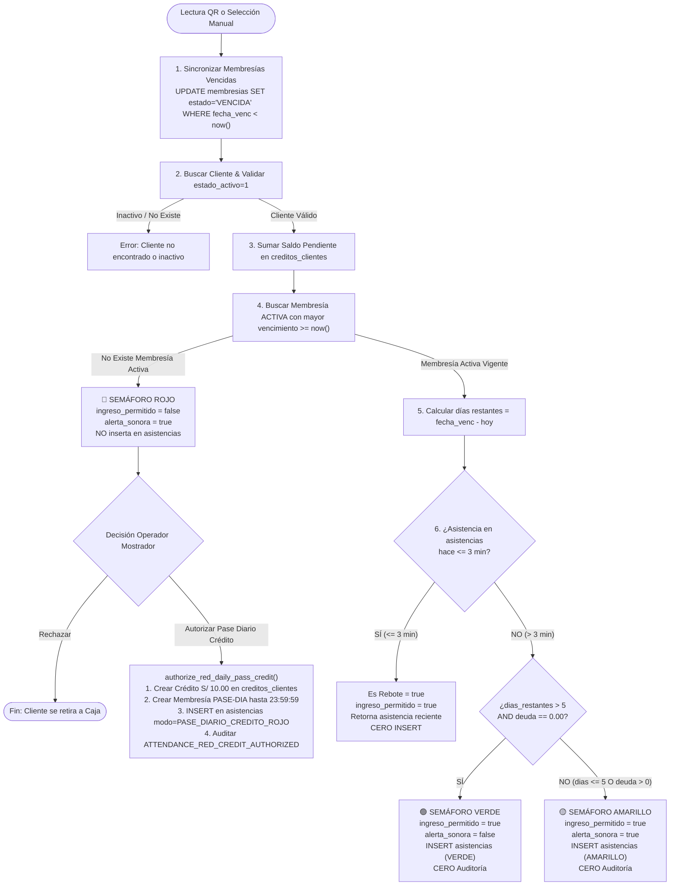

# 📋 CONTRATO TÉCNICO EJECUTABLE: SLICE 5
**Control de Asistencias Local, Semáforo Inteligente y Recuperación de Días**

---

## 1. Contexto & Objetivos del Slice 5

El **Slice 5** materializa el punto neurálgico de interacción física diaria en **ZaramaGYM**: el control de accesos en el mostrador de recepción. Su propósito es brindar una experiencia de validación de ingreso ultra-rápida (< 100 ms en local), determinista y visualmente inequívoca tanto para el recepcionista como para el socio del gimnasio.

### Principios Rectores de Arquitectura:
1. **Semáforo Inteligente de 3 Estados (Verde, Amarillo, Rojo):**
   - 🟢 **VERDE (Acceso Total):** El cliente cuenta con membresía activa con más de 5 días de vigencia y **cero deuda** pendiente en el motor de créditos (`creditos_clientes`). Ingreso automático sin alarmas.
   - 🟡 **AMARILLO (Alerta Preventiva con Ingreso Permitido):** Membresía activa por vencer ($\le 5$ días calendario) **O** el cliente registra deuda pendiente en `creditos_clientes` (por saldo de membresía, productos al crédito o pases diarios previos). Dispara alerta sonora/visual para que el recepcionista realice la gestión de cobranza o renovación en el acto, pero **no le bloquea la puerta**.
   - 🔴 **ROJO (Bloqueo de Acceso):** Cliente sin membresía o con membresía vencida. Bloquea el torniquete/pantalla e impide el ingreso directo. No registra fila en `asistencias` de forma prematura. Presenta en pantalla 2 acciones inmediatas: `[Rechazar (Enviar a Caja)]` o `[Autorizar Pase Diario a Crédito]`.
2. **Doble Vía de Identificación de Clientes:**
   - **Vía A (Óptica / Pistola Láser o Cámara):** Lectura del `codigo_qr_token` generado en el Slice 2 directamente desde la tarjeta física, teléfono del cliente o WhatsApp.
   - **Vía B (Manual por Olvido de QR):** Búsqueda reactiva por DNI/Carnet de Extranjería o selección directa por nombre/ID desde el padrón de socios de recepción (`modo_ingreso = 'MANUAL_OLVIDO_QR'`).
3. **Filtro Anti-Rebote Dinámico (3 Minutos):**
   - Evita la duplicación accidental o fraudulenta de asistencias cuando un lector láser lee dos veces seguidas o un cliente vuelve a pasar su credencial de inmediato. Si ya existe un ingreso para el mismo cliente en los últimos $N$ minutos (configurable, default: 3 min), se devuelve `es_rebote = true` con la asistencia previa sin insertar nuevos registros en la base de datos.
4. **Autorización Directa de Pase Diario a Crédito desde Semáforo Rojo:**
   - Permite al operador en recepción resolver la fricción con un socio que olvidó su billetera o no tiene dinero en efectivo: autoriza un Pase Diario que se anota como cuenta por cobrar en `creditos_clientes`, activa el pase válido hasta las `23:59:59` de la jornada y registra la asistencia como `PASE_DIARIO_CREDITO_ROJO`.
5. **Recuperación Manual de Días de Membresía:**
   - Mecanismo auditado y formal para extender la fecha de vencimiento de una membresía activa a favor del cliente (por motivos médicos, viajes, avería de instalaciones o cortes de agua/luz), respetando la restricción de que solo los planes que lo permiten (`permite_recuperacion_dias = 1`) pueden ser extendidos.
6. **Política "CERO Ruido" en Auditoría (`auditoria_logs`):**
   - Prohibido inflar la bitácora de auditoría con ingresos rutinarios (ni en VERDE ni en AMARILLO). La tabla de `asistencias` ya almacena el récord operacional de ingresos. En `auditoria_logs` solo se asientan eventos de alto impacto: `ATTENDANCE_RED_CREDIT_AUTHORIZED` y `MEMBERSHIP_DAYS_EXTENDED` con `detalles_json < 200 bytes`.

---

## 2. Esquema DDL de `src-tauri/migrations/005_attendance_extensions.sql`

```sql
-- ============================================================================
-- MIGRACIÓN 005: CONTROL DE ASISTENCIAS, SEMÁFORO, EXTENSIONES Y CONFIGURACIÓN
-- Motor: SQLite 3 (WAL Mode, Zero-Delete, Integridad Referencial Estricta)
-- ============================================================================

PRAGMA foreign_keys = ON;

-- 1. TABLA: CONFIGURACION_SISTEMA (Parámetros Dinámicos Globales del Gimnasio)
CREATE TABLE IF NOT EXISTS configuracion_sistema (
    clave           TEXT PRIMARY KEY,
    valor           TEXT NOT NULL,
    descripcion     TEXT,
    updated_at      TEXT NOT NULL DEFAULT (datetime('now', 'localtime'))
);

-- Seed de Parámetros de Operación por Defecto
INSERT OR IGNORE INTO configuracion_sistema (clave, valor, descripcion)
VALUES
    ('DIAS_ALERTA_AMARILLO', '5', 'Umbral de días calendario para alerta de vencimiento en semáforo amarillo'),
    ('MINUTOS_ANTIREBOTE_QR', '3', 'Ventana de minutos para ignorar lecturas duplicadas consecutivas del mismo cliente'),
    ('PRECIO_PASE_DIARIO_CREDITO_DEFAULT', '10.00', 'Precio por defecto para pase diario a crédito otorgado desde semáforo rojo');


-- 2. TABLA: ASISTENCIAS (Bitácora Operacional de Ingresos al Gimnasio)
CREATE TABLE IF NOT EXISTS asistencias (
    id                          INTEGER PRIMARY KEY AUTOINCREMENT,
    cliente_id                  INTEGER NOT NULL REFERENCES clientes(id) ON DELETE RESTRICT,
    membresia_id                INTEGER REFERENCES membresias_clientes(id) ON DELETE RESTRICT,
    fecha_hora_ingreso          TEXT NOT NULL DEFAULT (datetime('now', 'localtime')),
    modo_ingreso                TEXT NOT NULL CHECK(modo_ingreso IN (
        'QR_LOCAL',
        'QR_MOVIL_LAN',
        'MANUAL_OLVIDO_QR',
        'PASE_DIARIO_CREDITO_ROJO'
    )),
    color_semaforo              TEXT NOT NULL CHECK(color_semaforo IN ('VERDE', 'AMARILLO', 'ROJO')),
    motivo_semaforo             TEXT NOT NULL,
    dias_restantes_momento      INTEGER,
    deuda_pendiente_momento     DECIMAL(10,2) NOT NULL DEFAULT 0.00 CHECK(CAST(deuda_pendiente_momento AS REAL) >= 0),
    credito_generado_id         INTEGER REFERENCES creditos_clientes(id) ON DELETE RESTRICT,
    registrado_por_usuario_id   INTEGER NOT NULL REFERENCES usuarios_sistema(id) ON DELETE RESTRICT,
    notas                       TEXT,
    created_at                  TEXT NOT NULL DEFAULT (datetime('now', 'localtime'))
);

CREATE INDEX IF NOT EXISTS idx_asistencias_cliente ON asistencias(cliente_id);
CREATE INDEX IF NOT EXISTS idx_asistencias_membresia ON asistencias(membresia_id);
CREATE INDEX IF NOT EXISTS idx_asistencias_color ON asistencias(color_semaforo);
CREATE INDEX IF NOT EXISTS idx_asistencias_modo ON asistencias(modo_ingreso);
CREATE INDEX IF NOT EXISTS idx_asistencias_fecha_hora ON asistencias(fecha_hora_ingreso DESC);
CREATE INDEX IF NOT EXISTS idx_asistencias_rebote ON asistencias(cliente_id, fecha_hora_ingreso DESC);


-- 3. TABLA: EXTENSIONES_MEMBRESIA (Historial de Recuperación Justificada de Días)
CREATE TABLE IF NOT EXISTS extensiones_membresia (
    id                          INTEGER PRIMARY KEY AUTOINCREMENT,
    membresia_id                INTEGER NOT NULL REFERENCES membresias_clientes(id) ON DELETE RESTRICT,
    cliente_id                  INTEGER NOT NULL REFERENCES clientes(id) ON DELETE RESTRICT,
    dias_otorgados              INTEGER NOT NULL CHECK(dias_otorgados >= 1),
    fecha_vencimiento_anterior  TEXT NOT NULL,
    fecha_vencimiento_nueva     TEXT NOT NULL,
    motivo_justificacion        TEXT NOT NULL,
    autorizado_por_usuario_id   INTEGER NOT NULL REFERENCES usuarios_sistema(id) ON DELETE RESTRICT,
    created_at                  TEXT NOT NULL DEFAULT (datetime('now', 'localtime'))
);

CREATE INDEX IF NOT EXISTS idx_ext_membresia ON extensiones_membresia(membresia_id);
CREATE INDEX IF NOT EXISTS idx_ext_cliente ON extensiones_membresia(cliente_id);
CREATE INDEX IF NOT EXISTS idx_ext_autorizado ON extensiones_membresia(autorizado_por_usuario_id);
CREATE INDEX IF NOT EXISTS idx_ext_created_at ON extensiones_membresia(created_at DESC);
```

### Diccionario de Datos Formal:

| Tabla | Columna | Tipo SQLite | Restricciones / Índices | Nulabilidad | Descripción |
| :--- | :--- | :--- | :--- | :--- | :--- |
| `configuracion_sistema` | `clave` | `TEXT` | `PRIMARY KEY` | `NOT NULL` | Clave identificadora del parámetro (ej. `MINUTOS_ANTIREBOTE_QR`). |
| `configuracion_sistema` | `valor` | `TEXT` | - | `NOT NULL` | Valor del parámetro persistido como string para versatilidad tipada. |
| `configuracion_sistema` | `descripcion` | `TEXT` | - | `NULL` | Glosa descriptiva para soporte y documentación del parámetro. |
| `configuracion_sistema` | `updated_at` | `TEXT` | `DEFAULT datetime('now', 'localtime')` | `NOT NULL` | Marca temporal de última modificación del parámetro. |
| `asistencias` | `id` | `INTEGER` | `PRIMARY KEY AUTOINCREMENT` | `NOT NULL` | Identificador único de la asistencia. |
| `asistencias` | `cliente_id` | `INTEGER` | `FK -> clientes(id) ON DELETE RESTRICT` | `NOT NULL` | Cliente que ingresa al gimnasio. |
| `asistencias` | `membresia_id` | `INTEGER` | `FK -> membresias_clientes(id)` | `NULL` | Membresía activa o pase que amparó el acceso. |
| `asistencias` | `fecha_hora_ingreso`| `TEXT` | `DEFAULT datetime('now', 'localtime')` | `NOT NULL` | Fecha y hora exacta de cruce del mostrador. |
| `asistencias` | `modo_ingreso` | `TEXT` | `CHECK('QR_LOCAL', 'QR_MOVIL_LAN', ...)` | `NOT NULL` | Canal tecnológico de ingreso. |
| `asistencias` | `color_semaforo` | `TEXT` | `CHECK('VERDE', 'AMARILLO', 'ROJO')` | `NOT NULL` | Dictamen del evaluador semafórico al ingresar. |
| `asistencias` | `motivo_semaforo` | `TEXT` | - | `NOT NULL` | Razón del color (ej. "Membresía activa", "Vence en 2 días y debe S/ 30"). |
| `asistencias` | `dias_restantes_momento`| `INTEGER` | - | `NULL` | Días de vigencia calculados en el instante de la lectura. |
| `asistencias` | `deuda_pendiente_momento`| `DECIMAL(10,2)`| `DEFAULT 0.00` | `NOT NULL` | Saldo global pendiente en `creditos_clientes` al momento del ingreso. |
| `asistencias` | `credito_generado_id`| `INTEGER` | `FK -> creditos_clientes(id)` | `NULL` | Crédito emitido si el acceso provino de autorización en ROJO. |
| `asistencias` | `registrado_por_usuario_id`| `INTEGER` | `FK -> usuarios_sistema(id)` | `NOT NULL` | Operador en sesión que registró/supervisó el ingreso. |
| `asistencias` | `notas` | `TEXT` | - | `NULL` | Observaciones adicionales del operador en mostrador. |
| `extensiones_membresia` | `id` | `INTEGER` | `PRIMARY KEY AUTOINCREMENT` | `NOT NULL` | Identificador único de la extensión concedida. |
| `extensiones_membresia` | `membresia_id`| `INTEGER` | `FK -> membresias_clientes(id)` | `NOT NULL` | Membresía extendida en su fecha de vigencia. |
| `extensiones_membresia` | `cliente_id` | `INTEGER` | `FK -> clientes(id)` | `NOT NULL` | Cliente titular beneficiado. |
| `extensiones_membresia` | `dias_otorgados`| `INTEGER` | `CHECK(dias_otorgados >= 1)` | `NOT NULL` | Cantidad de días calendario agregados. |
| `extensiones_membresia` | `fecha_vencimiento_anterior`| `TEXT` | `ISO 8601` | `NOT NULL` | Fecha original previa a la modificación. |
| `extensiones_membresia` | `fecha_vencimiento_nueva`| `TEXT` | `ISO 8601` | `NOT NULL` | Nueva fecha de corte calculada ($+N$ días hasta 23:59:59). |
| `extensiones_membresia` | `motivo_justificacion`| `TEXT` | - | `NOT NULL` | Argumento de la extensión (mínimo 5 caracteres). |
| `extensiones_membresia` | `autorizado_por_usuario_id`| `INTEGER` | `FK -> usuarios_sistema(id)` | `NOT NULL` | Operador responsable que autorizó la prórroga. |

---

## 3. Algoritmo del Semáforo Inteligente, Anti-Rebote y Recuperación



### Reglas de Negocio Paso a Paso:

#### 1. Sincronización Automática de Vencimientos
Antes de cualquier evaluación en `check_in_client`, se ejecuta la sentencia atómica:
```sql
UPDATE membresias_clientes
SET estado = 'VENCIDA', updated_at = datetime('now', 'localtime')
WHERE estado = 'ACTIVA' AND fecha_vencimiento < datetime('now', 'localtime');
```
Esto garantiza que si el reloj superó las `23:59:59` del día de vencimiento, la membresía ya no se compute como vigente.

#### 2. Detección y Filtro Anti-Rebote (3 Minutos)
- Se obtiene la configuración `MINUTOS_ANTIREBOTE_QR` de `configuracion_sistema` (default: 3 minutos).
- Se busca si existe un registro en `asistencias` para ese `cliente_id` donde:
  ```sql
  fecha_hora_ingreso >= datetime('now', 'localtime', '-' || ? || ' minutes')
  ORDER BY fecha_hora_ingreso DESC LIMIT 1;
  ```
- Si existe:
  - Se retorna `CheckInEvaluationDto` con `es_rebote = true`, `ingreso_permitido = true`, y se rescata el `asistencia_id` e información de esa asistencia previa.
  - **No se realiza ninguna inserción** en la base de datos ni se alteran contadores.

#### 3. Clasificación Semafórica (Sin Rebote):
- **Cálculo de Días Restantes:**
  - Se toma la fecha calendario local de hoy (`YYYY-MM-DD`) y la fecha calendario del `fecha_vencimiento` (`YYYY-MM-DD`).
  - Si vence hoy a las `23:59:59`, `dias_restantes = 0`.
  - Si vence mañana, `dias_restantes = 1`.
- **🟢 VERDE:**
  - Condición: `dias_restantes > 5` Y `deuda_total_pendiente == 0.00`.
  - Acción: Inserta en `asistencias` con `color_semaforo = 'VERDE'`, `motivo_semaforo = 'Membresía activa vigente'`.
  - Sonido: Tono suave de éxito. Pantalla: Verde esmeralda.
  - Auditoría: **CERO** registros en `auditoria_logs`.
- **🟡 AMARILLO:**
  - Condición: `dias_restantes <= 5` O `deuda_total_pendiente > 0.00`.
  - Motivo estructurado:
    - Si ambas condiciones: `"Membresía por vencer en {N} día(s) y Deuda pendiente de S/ {M}"` (o `"vence hoy"` si $N=0$).
    - Si solo días: `"Membresía por vencer en {N} día(s)"` (o `"Membresía vence hoy"` si $N=0$).
    - Si solo deuda: `"Cliente registra saldo deudor pendiente de S/ {M}"`.
  - Acción: Inserta en `asistencias` con `color_semaforo = 'AMARILLO'`, `ingreso_permitido = true`.
  - Sonido: Tono de advertencia / campana. Pantalla: Ámbar vibrante.
  - Auditoría: **CERO** registros en `auditoria_logs`.
- **🔴 ROJO:**
  - Condición: Sin membresías activas (todas vencidas, anuladas o inexistentes).
  - Motivo: `"Membresía vencida el {YYYY-MM-DD}"` o `"Cliente no registra membresía activa"`. Si tiene deuda, añade: `" (Deuda pendiente: S/ {M})"`.
  - Acción: `ingreso_permitido = false`, `alerta_sonora = true`. **NO se inserta fila en `asistencias`** en esta fase.
  - Sonido: Zumbido de rechazo. Pantalla: Rojo carmesí con modal de decisión inmediata.

#### 4. Autorización de Pase Diario a Crédito (`authorize_red_daily_pass_credit`)
Cuando un cliente bloqueado en ROJO solicita acceso excepcional:
1. El recepcionista o supervisor pulsa el botón **`[Autorizar Pase Diario a Crédito]`**.
2. En una transacción SQLite con `BEGIN IMMEDIATE`:
   - Determina el precio del pase: si se especifica `monto_pase` se respeta, de lo contrario se consulta el valor de `configuracion_sistema` (`PRECIO_PASE_DIARIO_CREDITO_DEFAULT`) o el plan con código `PASE-DIA` (default: `10.00`).
   - Inserta en `creditos_clientes`:
     ```sql
     INSERT INTO creditos_clientes (
         cliente_id, venta_origen_id, origen_credito, descripcion,
         monto_total, monto_pagado, saldo_pendiente, estado,
         registrado_por_usuario_id, fecha_emision
     ) VALUES (
         ?, NULL, 'PASE_DIARIO_SEMAFORO_ROJO', 'Pase Diario autorizado en Semáforo Rojo',
         ?, 0.00, ?, 'PENDIENTE',
         ?, datetime('now', 'localtime')
     );
     ```
   - Inserta en `membresias_clientes` un pase diario activo hasta las `23:59:59` de la fecha actual:
     ```sql
     INSERT INTO membresias_clientes (
         cliente_id, plan_id, venta_id, fecha_inicio, fecha_vencimiento,
         precio_pactado, estado, registrado_por_usuario_id
     ) VALUES (
         ?, (SELECT id FROM planes WHERE codigo = 'PASE-DIA' LIMIT 1),
         NULL, datetime('now', 'localtime'), date('now', 'localtime') || ' 23:59:59',
         ?, 'ACTIVA', ?
     );
     ```
   - Inserta el registro oficial de ingreso en `asistencias`:
     ```sql
     INSERT INTO asistencias (
         cliente_id, membresia_id, modo_ingreso, color_semaforo,
         motivo_semaforo, dias_restantes_momento, deuda_pendiente_momento,
         credito_generado_id, registrado_por_usuario_id, notas
     ) VALUES (
         ?, ?, 'PASE_DIARIO_CREDITO_ROJO', 'ROJO',
         'Pase Diario a crédito autorizado por recepción', 0,
         ?, ?, ?, ?
     );
     ```
   - Registra en `auditoria_logs`:
     - `accion = 'ATTENDANCE_RED_CREDIT_AUTHORIZED'`
     - `modulo = 'ASISTENCIAS'`
     - `detalles_json = '{"cliente_id": X, "credito_id": Y, "monto": "10.00"}'` (< 200 bytes).
3. Devuelve `CheckInEvaluationDto` con `ingreso_permitido = true`, `color_semaforo = ROJO`, `modo_ingreso = PASE_DIARIO_CREDITO_ROJO` y `credito_generado_id`.

#### 5. Recuperación Manual de Días de Membresía (`extend_membership_days`)
1. **Validaciones Previas:**
   - Membresía debe existir y estar en `estado = 'ACTIVA'`.
   - El plan vinculado (`planes`) debe tener `permite_recuperacion_dias = 1`. Si es 0 (ej. `PASE-DIA`), se rechaza con error: `AppError::Validation("El plan de esta membresía no permite recuperación o prórroga de días")`.
   - `dias_otorgados >= 1`.
   - `motivo_justificacion.trim().len() >= 5`.
2. **Cálculo de Nueva Fecha:**
   - Se toma la fecha base del `fecha_vencimiento` de la membresía (ej. `2026-11-20 23:59:59`).
   - Se le adicionan `dias_otorgados` días calendario manteniendo la hora en `23:59:59`.
3. **Transacción Atómica (`BEGIN IMMEDIATE`):**
   - Se actualiza `membresias_clientes`:
     ```sql
     UPDATE membresias_clientes
     SET fecha_vencimiento = ?, updated_at = datetime('now', 'localtime')
     WHERE id = ?;
     ```
   - Se inserta en `extensiones_membresia`:
     ```sql
     INSERT INTO extensiones_membresia (
         membresia_id, cliente_id, dias_otorgados, fecha_vencimiento_anterior,
         fecha_vencimiento_nueva, motivo_justificacion, autorizado_por_usuario_id
     ) VALUES (?, ?, ?, ?, ?, ?, ?);
     ```
   - Se audita en `auditoria_logs`:
     - `accion = 'MEMBERSHIP_DAYS_EXTENDED'`
     - `modulo = 'MEMBRESIAS'`
     - `detalles_json = '{"membresia_id": X, "dias": N, "nueva_fecha": "..."}'` (< 200 bytes).

---

## 4. Modelos de Dominio Rust (`src-tauri/src/models/attendance.rs`)

```rust
use crate::errors::AppError;
use rust_decimal::Decimal;
use serde::{Deserialize, Serialize};
use std::fmt;
use std::str::FromStr;

// ============================================================================
// ENUMS DE DOMINIO DE ASISTENCIAS Y SEMÁFORO
// ============================================================================

#[derive(Debug, Clone, Copy, PartialEq, Eq, Serialize, Deserialize)]
#[serde(rename_all = "SCREAMING_SNAKE_CASE")]
pub enum TrafficLightColor {
    Verde,
    Amarillo,
    Rojo,
}

impl fmt::Display for TrafficLightColor {
    fn fmt(&self, f: &mut fmt::Formatter<'_>) -> fmt::Result {
        match self {
            Self::Verde => write!(f, "VERDE"),
            Self::Amarillo => write!(f, "AMARILLO"),
            Self::Rojo => write!(f, "ROJO"),
        }
    }
}

impl FromStr for TrafficLightColor {
    type Err = AppError;
    fn from_str(s: &str) -> Result<Self, Self::Err> {
        match s.trim().to_uppercase().as_str() {
            "VERDE" => Ok(Self::Verde),
            "AMARILLO" => Ok(Self::Amarillo),
            "ROJO" => Ok(Self::Rojo),
            other => Err(AppError::Validation(format!(
                "Color de semáforo inválido: {}",
                other
            ))),
        }
    }
}

#[derive(Debug, Clone, Copy, PartialEq, Eq, Serialize, Deserialize)]
#[serde(rename_all = "SCREAMING_SNAKE_CASE")]
pub enum AttendanceCheckInMode {
    QrLocal,
    QrMovilLan,
    ManualOlvidoQr,
    PaseDiarioCreditoRojo,
}

impl fmt::Display for AttendanceCheckInMode {
    fn fmt(&self, f: &mut fmt::Formatter<'_>) -> fmt::Result {
        match self {
            Self::QrLocal => write!(f, "QR_LOCAL"),
            Self::QrMovilLan => write!(f, "QR_MOVIL_LAN"),
            Self::ManualOlvidoQr => write!(f, "MANUAL_OLVIDO_QR"),
            Self::PaseDiarioCreditoRojo => write!(f, "PASE_DIARIO_CREDITO_ROJO"),
        }
    }
}

impl FromStr for AttendanceCheckInMode {
    type Err = AppError;
    fn from_str(s: &str) -> Result<Self, Self::Err> {
        match s.trim().to_uppercase().as_str() {
            "QR_LOCAL" => Ok(Self::QrLocal),
            "QR_MOVIL_LAN" => Ok(Self::QrMovilLan),
            "MANUAL_OLVIDO_QR" => Ok(Self::ManualOlvidoQr),
            "PASE_DIARIO_CREDITO_ROJO" => Ok(Self::PaseDiarioCreditoRojo),
            other => Err(AppError::Validation(format!(
                "Modo de ingreso desconocido: {}",
                other
            ))),
        }
    }
}

// ============================================================================
// DTOs DE ENTRADA (INPUTS) CON DUAL-BINDING SERDE
// ============================================================================

#[derive(Debug, Clone, Serialize, Deserialize)]
#[serde(rename_all = "camelCase")]
pub struct CheckInInput {
    #[serde(alias = "qr_token")]
    pub qr_token: Option<String>,
    #[serde(alias = "cliente_id")]
    pub cliente_id: Option<i64>,
    #[serde(alias = "numero_documento")]
    pub numero_documento: Option<String>,
    #[serde(alias = "modo_ingreso")]
    pub modo_ingreso: Option<AttendanceCheckInMode>,
    pub notas: Option<String>,
}

#[derive(Debug, Clone, Serialize, Deserialize)]
#[serde(rename_all = "camelCase")]
pub struct AuthorizeRedPassInput {
    #[serde(alias = "cliente_id")]
    pub cliente_id: i64,
    #[serde(alias = "monto_pase")]
    pub monto_pase: Option<Decimal>,
    pub notas: Option<String>,
}

#[derive(Debug, Clone, Default, Serialize, Deserialize)]
#[serde(rename_all = "camelCase")]
pub struct AttendanceFilter {
    #[serde(alias = "fecha_desde")]
    pub fecha_desde: Option<String>,
    #[serde(alias = "fecha_hasta")]
    pub fecha_hasta: Option<String>,
    #[serde(alias = "color_semaforo")]
    pub color_semaforo: Option<TrafficLightColor>,
    #[serde(alias = "modo_ingreso")]
    pub modo_ingreso: Option<AttendanceCheckInMode>,
    #[serde(alias = "cliente_id")]
    pub cliente_id: Option<i64>,
    pub busqueda: Option<String>,
    pub limit: Option<i64>,
    pub offset: Option<i64>,
}

#[derive(Debug, Clone, Serialize, Deserialize)]
#[serde(rename_all = "camelCase")]
pub struct ExtendMembershipInput {
    #[serde(alias = "membresia_id")]
    pub membresia_id: i64,
    #[serde(alias = "dias_otorgados")]
    pub dias_otorgados: i64,
    #[serde(alias = "motivo_justificacion")]
    pub motivo_justificacion: String,
}

#[derive(Debug, Clone, Default, Serialize, Deserialize)]
#[serde(rename_all = "camelCase")]
pub struct MembershipExtensionFilter {
    #[serde(alias = "membresia_id")]
    pub membresia_id: Option<i64>,
    #[serde(alias = "cliente_id")]
    pub cliente_id: Option<i64>,
    #[serde(alias = "fecha_desde")]
    pub fecha_desde: Option<String>,
    #[serde(alias = "fecha_hasta")]
    pub fecha_hasta: Option<String>,
    pub limit: Option<i64>,
    pub offset: Option<i64>,
}

#[derive(Debug, Clone, Default, Serialize, Deserialize)]
#[serde(rename_all = "camelCase")]
pub struct UpdateSystemConfigInput {
    #[serde(alias = "dias_alerta_amarillo")]
    pub dias_alerta_amarillo: Option<i64>,
    #[serde(alias = "minutos_antirebote_qr")]
    pub minutos_antirebote_qr: Option<i64>,
    #[serde(alias = "precio_pase_diario_credito_default")]
    pub precio_pase_diario_credito_default: Option<Decimal>,
}

// ============================================================================
// DTOs DE SALIDA (RESPONSES) CON DUAL-BINDING CAMELCASE
// ============================================================================

#[derive(Debug, Clone, Serialize, Deserialize)]
#[serde(rename_all = "camelCase")]
pub struct CheckInEvaluationDto {
    pub asistencia_id: Option<i64>,
    pub cliente_id: i64,
    pub nombre_completo: String,
    pub tipo_documento: String,
    pub numero_documento: String,
    pub foto_perfil_data_url: Option<String>,
    pub color_semaforo: TrafficLightColor,
    pub ingreso_permitido: bool,
    pub alerta_sonora: bool,
    pub es_rebote: bool,
    pub motivo_semaforo: String,
    pub membresia_id: Option<i64>,
    pub nombre_plan: Option<String>,
    pub fecha_vencimiento: Option<String>,
    pub dias_restantes: Option<i64>,
    pub deuda_total_pendiente: Decimal,
    pub modo_ingreso: AttendanceCheckInMode,
    pub fecha_hora_ingreso: String,
    pub credito_generado_id: Option<i64>,
}

#[derive(Debug, Clone, Serialize, Deserialize)]
#[serde(rename_all = "camelCase")]
pub struct AttendanceListItemDto {
    pub id: i64,
    pub cliente_id: i64,
    pub nombre_completo: String,
    pub tipo_documento: String,
    pub numero_documento: String,
    pub membresia_id: Option<i64>,
    pub nombre_plan: Option<String>,
    pub fecha_hora_ingreso: String,
    pub modo_ingreso: AttendanceCheckInMode,
    pub color_semaforo: TrafficLightColor,
    pub motivo_semaforo: String,
    pub dias_restantes_momento: Option<i64>,
    pub deuda_pendiente_momento: Decimal,
    pub credito_generado_id: Option<i64>,
    pub registrado_por_usuario_id: i64,
    pub registrado_por_nombre: String,
    pub notas: Option<String>,
    pub created_at: String,
}

#[derive(Debug, Clone, Serialize, Deserialize)]
#[serde(rename_all = "camelCase")]
pub struct AttendanceTodaySummaryDto {
    pub total_ingresos_hoy: i64,
    pub total_verde: i64,
    pub total_amarillo: i64,
    pub total_rojo_autorizados: i64,
    pub total_qr_local: i64,
    pub total_manual_olvido: i64,
    pub total_pase_credito: i64,
    pub total_qr_movil: i64,
    pub ultimo_ingreso_hora: Option<String>,
}

#[derive(Debug, Clone, Serialize, Deserialize)]
#[serde(rename_all = "camelCase")]
pub struct MembershipExtensionDto {
    pub id: i64,
    pub membresia_id: i64,
    pub cliente_id: i64,
    pub nombre_cliente: String,
    pub nombre_plan: String,
    pub dias_otorgados: i64,
    pub fecha_vencimiento_anterior: String,
    pub fecha_vencimiento_nueva: String,
    pub motivo_justificacion: String,
    pub autorizado_por_usuario_id: i64,
    pub autorizado_por_nombre: String,
    pub created_at: String,
}

#[derive(Debug, Clone, Serialize, Deserialize)]
#[serde(rename_all = "camelCase")]
pub struct SystemConfigDto {
    pub dias_alerta_amarillo: i64,
    pub minutos_antirebote_qr: i64,
    pub precio_pase_diario_credito_default: Decimal,
    pub updated_at: String,
}
```

---

## 5. Comandos IPC de Tauri v2 (`src-tauri/src/commands/attendance_commands.rs`)

Los 8 comandos IPC son expuestos de forma atómica y tipada en Tauri v2:

```rust
#![allow(non_snake_case)]

use crate::errors::AppError;
use crate::models::{
    AttendanceFilter, AttendanceListItemDto, AttendanceTodaySummaryDto, AuthorizeRedPassInput,
    CheckInEvaluationDto, CheckInInput, ExtendMembershipInput, MembershipExtensionDto,
    MembershipExtensionFilter, SystemConfigDto, UpdateSystemConfigInput, UserRole,
};
use crate::services::attendance_service;
use crate::state::AppState;
use tauri::State;

// ============================================================================
// 1. EVALUACIÓN Y CHECK-IN DEL SEMÁFORO INTELIGENTE
// ============================================================================

#[tauri::command]
pub async fn check_in_client(
    input: CheckInInput,
    state: State<'_, AppState>,
) -> Result<CheckInEvaluationDto, AppError> {
    let session = state.require_unlocked_session().await?;
    attendance_service::check_in_client(&state.pool, &session, input).await
}

// ============================================================================
// 2. AUTORIZACIÓN DE PASE DIARIO A CRÉDITO DESDE SEMÁFORO ROJO
// ============================================================================

#[tauri::command]
pub async fn authorize_red_daily_pass_credit(
    input: AuthorizeRedPassInput,
    state: State<'_, AppState>,
) -> Result<CheckInEvaluationDto, AppError> {
    let session = state.require_unlocked_session().await?;
    attendance_service::authorize_red_daily_pass_credit(&state.pool, &session, input).await
}

// ============================================================================
// 3. CONSULTA DE HISTORIAL Y LISTADO DE ASISTENCIAS
// ============================================================================

#[tauri::command]
pub async fn list_attendances(
    filter: Option<AttendanceFilter>,
    state: State<'_, AppState>,
) -> Result<Vec<AttendanceListItemDto>, AppError> {
    let session = state.require_unlocked_session().await?;
    let f = filter.unwrap_or_default();
    attendance_service::list_attendances(&state.pool, &session, &f).await
}

// ============================================================================
// 4. RESUMEN DE ASISTENCIAS DE LA JORNADA (HOY)
// ============================================================================

#[tauri::command]
pub async fn get_attendance_summary_today(
    state: State<'_, AppState>,
) -> Result<AttendanceTodaySummaryDto, AppError> {
    let session = state.require_unlocked_session().await?;
    attendance_service::get_attendance_summary_today(&state.pool, &session).await
}

// ============================================================================
// 5. EXTENSIÓN Y RECUPERACIÓN MANUAL DE DÍAS DE MEMBRESÍA
// ============================================================================

#[tauri::command]
pub async fn extend_membership_days(
    input: ExtendMembershipInput,
    state: State<'_, AppState>,
) -> Result<MembershipExtensionDto, AppError> {
    let session = state.require_unlocked_session().await?;
    attendance_service::extend_membership_days(&state.pool, &session, input).await
}

// ============================================================================
// 6. HISTORIAL DE EXTENSIONES DE MEMBRESÍA
// ============================================================================

#[tauri::command]
pub async fn list_membership_extensions(
    filter: Option<MembershipExtensionFilter>,
    state: State<'_, AppState>,
) -> Result<Vec<MembershipExtensionDto>, AppError> {
    let session = state.require_unlocked_session().await?;
    let f = filter.unwrap_or_default();
    attendance_service::list_membership_extensions(&state.pool, &session, &f).await
}

// ============================================================================
// 7. CONSULTA DE PARÁMETROS GLOBALES DEL SISTEMA
// ============================================================================

#[tauri::command]
pub async fn get_system_config(
    state: State<'_, AppState>,
) -> Result<SystemConfigDto, AppError> {
    let session = state.require_unlocked_session().await?;
    attendance_service::get_system_config(&state.pool, &session).await
}

// ============================================================================
// 8. ACTUALIZACIÓN DE PARÁMETROS GLOBALES DEL SISTEMA (ADMIN / SUPERVISOR)
// ============================================================================

#[tauri::command]
pub async fn update_system_config(
    input: UpdateSystemConfigInput,
    state: State<'_, AppState>,
) -> Result<SystemConfigDto, AppError> {
    let session = state.require_unlocked_session().await?;
    if session.rol == UserRole::Recepcionista {
        return Err(AppError::Forbidden(
            "Solo administradores y supervisores pueden modificar la configuración del sistema"
                .to_string(),
        ));
    }
    attendance_service::update_system_config(&state.pool, &session, input).await
}
```

---

## 6. Interfaces TypeScript Frontend (`src/types/attendance.ts`)

```typescript
// ============================================================================
// TIPOS E INTERFACES FRONTEND: CONTROL DE ASISTENCIAS (SLICE 5)
// Ubicación: src/types/attendance.ts
// ============================================================================

export type TrafficLightColor = 'VERDE' | 'AMARILLO' | 'ROJO';

export type AttendanceCheckInMode = 
  | 'QR_LOCAL' 
  | 'QR_MOVIL_LAN' 
  | 'MANUAL_OLVIDO_QR' 
  | 'PASE_DIARIO_CREDITO_ROJO';

export interface CheckInInput {
  qrToken?: string;
  clienteId?: number;
  numeroDocumento?: string;
  modoIngreso?: AttendanceCheckInMode;
  notas?: string;
}

export interface AuthorizeRedPassInput {
  clienteId: number;
  montoPase?: string | number;
  notas?: string;
}

export interface AttendanceFilter {
  fechaDesde?: string;
  fechaHasta?: string;
  colorSemaforo?: TrafficLightColor;
  modoIngreso?: AttendanceCheckInMode;
  clienteId?: number;
  busqueda?: string;
  limit?: number;
  offset?: number;
}

export interface ExtendMembershipInput {
  membresiaId: number;
  diasOtorgados: number;
  motivoJustificacion: string;
}

export interface MembershipExtensionFilter {
  membresiaId?: number;
  clienteId?: number;
  fechaDesde?: string;
  fechaHasta?: string;
  limit?: number;
  offset?: number;
}

export interface UpdateSystemConfigInput {
  diasAlertaAmarillo?: number;
  minutosAntireboteQr?: number;
  precioPaseDiarioCreditoDefault?: string | number;
}

export interface CheckInEvaluationDto {
  asistenciaId: number | null;
  clienteId: number;
  nombreCompleto: string;
  tipoDocumento: string;
  numeroDocumento: string;
  fotoPerfilDataUrl: string | null;
  colorSemaforo: TrafficLightColor;
  ingresoPermitido: bool;
  alertaSonora: bool;
  esRebote: bool;
  motivoSemaforo: string;
  membresiaId: number | null;
  nombrePlan: string | null;
  fechaVencimiento: string | null;
  diasRestantes: number | null;
  deudaTotalPendiente: string;
  modoIngreso: AttendanceCheckInMode;
  fechaHoraIngreso: string;
  creditoGeneradoId: number | null;
}

export interface AttendanceListItemDto {
  id: number;
  clienteId: number;
  nombreCompleto: string;
  tipoDocumento: string;
  numeroDocumento: string;
  membresiaId: number | null;
  nombrePlan: string | null;
  fechaHoraIngreso: string;
  modoIngreso: AttendanceCheckInMode;
  colorSemaforo: TrafficLightColor;
  motivoSemaforo: string;
  diasRestantesMomento: number | null;
  deudaPendienteMomento: string;
  creditoGeneradoId: number | null;
  registradoPorUsuarioId: number;
  registradoPorNombre: string;
  notas: string | null;
  createdAt: string;
}

export interface AttendanceTodaySummaryDto {
  totalIngresosHoy: number;
  totalVerde: number;
  totalAmarillo: number;
  totalRojoAutorizados: number;
  totalQrLocal: number;
  totalManualOlvido: number;
  totalPaseCredito: number;
  totalQrMovil: number;
  ultimoIngresoHora: string | null;
}

export interface MembershipExtensionDto {
  id: number;
  membresiaId: number;
  clienteId: number;
  nombreCliente: string;
  nombrePlan: string;
  diasOtorgados: number;
  fechaVencimientoAnterior: string;
  fechaVencimientoNueva: string;
  motivoJustificacion: string;
  autorizadoPorUsuarioId: number;
  autorizadoPorNombre: string;
  createdAt: string;
}

export interface SystemConfigDto {
  diasAlertaAmarillo: number;
  minutosAntireboteQr: number;
  precioPaseDiarioCreditoDefault: string;
  updatedAt: string;
}
```

---

## 7. Cliente IPC Frontend (`src/services/ipc/attendanceIpc.ts`)

```typescript
// ============================================================================
// SERVICIOS IPC: CONTROL DE ASISTENCIAS, SEMÁFORO Y EXTENSIONES (SLICE 5)
// Envoltorios tipados para Tauri v2 con dual-binding camelCase + snake_case
// Ubicación: src/services/ipc/attendanceIpc.ts
// ============================================================================

import {
  AttendanceFilter,
  AttendanceListItemDto,
  AttendanceTodaySummaryDto,
  AuthorizeRedPassInput,
  CheckInEvaluationDto,
  CheckInInput,
  ExtendMembershipInput,
  MembershipExtensionDto,
  MembershipExtensionFilter,
  SystemConfigDto,
  UpdateSystemConfigInput,
} from '../../types/attendance';
import { safeInvoke } from './client';

export const attendanceIpc = {
  /**
   * Ejecuta la evaluación determinista del semáforo y registro de asistencia por QR o DNI
   */
  async checkInClient(input: CheckInInput): Promise<CheckInEvaluationDto> {
    return safeInvoke<CheckInEvaluationDto>('check_in_client', { input });
  },

  /**
   * Autoriza el ingreso en semáforo rojo otorgando un Pase Diario a crédito
   */
  async authorizeRedDailyPassCredit(input: AuthorizeRedPassInput): Promise<CheckInEvaluationDto> {
    return safeInvoke<CheckInEvaluationDto>('authorize_red_daily_pass_credit', { input });
  },

  /**
   * Lista el historial de asistencias con filtros por fecha, semáforo, modo o cliente
   */
  async listAttendances(filter: AttendanceFilter = {}): Promise<AttendanceListItemDto[]> {
    return safeInvoke<AttendanceListItemDto[]>('list_attendances', { filter });
  },

  /**
   * Obtiene las métricas agregadas de aforo y semáforos de la jornada en curso
   */
  async getAttendanceSummaryToday(): Promise<AttendanceTodaySummaryDto> {
    return safeInvoke<AttendanceTodaySummaryDto>('get_attendance_summary_today');
  },

  /**
   * Otorga una extensión manual de días justificada a una membresía activa
   */
  async extendMembershipDays(input: ExtendMembershipInput): Promise<MembershipExtensionDto> {
    return safeInvoke<MembershipExtensionDto>('extend_membership_days', { input });
  },

  /**
   * Consulta el historial de prórrogas y recuperación de días otorgadas
   */
  async listMembershipExtensions(
    filter: MembershipExtensionFilter = {}
  ): Promise<MembershipExtensionDto[]> {
    return safeInvoke<MembershipExtensionDto[]>('list_membership_extensions', { filter });
  },

  /**
   * Obtiene los parámetros operativos del sistema (umbral amarillo, anti-rebote, precio crédito)
   */
  async getSystemConfig(): Promise<SystemConfigDto> {
    return safeInvoke<SystemConfigDto>('get_system_config');
  },

  /**
   * Modifica los parámetros operativos del sistema (solo Supervisor y Administrador)
   */
  async updateSystemConfig(input: UpdateSystemConfigInput): Promise<SystemConfigDto> {
    return safeInvoke<SystemConfigDto>('update_system_config', { input });
  },
};
```

---

## 8. Casos de Prueba Canónicos (Backend & Frontend)

### Matriz de Casos de Prueba Backend (`slice_5_tests.rs`)

| ID | Escenario | Entrada | Estado DB Previo | Resultado Esperado | Verificación Crítica |
| :--- | :--- | :--- | :--- | :--- | :--- |
| **TC-S5-01** | Check-in Verde Perfecto | `qr_token` de cliente | Membresía vence en 20 días, deuda = 0.00 | `color: VERDE`, `permitido: true`, `sonido: false`, `rebote: false` | 1 fila en `asistencias`. **CERO registros en `auditoria_logs`**. |
| **TC-S5-02** | Check-in Amarillo por Vencimiento Próximo | `qr_token` de cliente | Membresía vence en 3 días ($\le 5$), deuda = 0.00 | `color: AMARILLO`, `permitido: true`, `sonido: true`, `rebote: false` | Motivo: `"Membresía por vencer en 3 día(s)"`. 1 fila en `asistencias`. |
| **TC-S5-03** | Check-in Amarillo por Deuda Pendiente | `qr_token` de cliente | Membresía vence en 25 días, crédito de S/ 40 pendiente | `color: AMARILLO`, `permitido: true`, `sonido: true` | Motivo: `"saldo deudor pendiente de S/ 40.00"`. 1 fila en `asistencias`. |
| **TC-S5-04** | Check-in Amarillo Doble (Vence hoy + Deuda) | `qr_token` de cliente | Membresía vence hoy a las 23:59:59, deuda = S/ 15.00 | `color: AMARILLO`, `permitido: true`, `sonido: true` | Motivo incluye ambos factores. `dias_restantes = 0`. |
| **TC-S5-05** | Check-in Rojo Bloqueado (Membresía Vencida) | `qr_token` de cliente | Membresía venció ayer | `color: ROJO`, `permitido: false`, `sonido: true` | **CERO inserciones en `asistencias`**. Membresía pasa a `VENCIDA`. |
| **TC-S5-06** | Check-in Rojo Bloqueado (Sin Membresía) | `qr_token` de cliente nuevo | Cliente sin ninguna membresía registrada | `color: ROJO`, `permitido: false`, `asistencia_id: None` | Bloqueo en puerta. |
| **TC-S5-07** | Filtro Anti-Rebote 3 Minutos | 2 lecturas consecutivas del mismo QR con 10s de diferencia | Cliente con Semáforo Verde | 1ra lectura: `es_rebote = false`. 2da lectura: `es_rebote = true`, `permitido = true` | Exactamente 1 fila en `asistencias` (no duplica métricas). |
| **TC-S5-08** | Ingreso Manual por Olvido de QR | `numero_documento` de cliente | Cliente activo con membresía mensual vigente | `modo_ingreso = MANUAL_OLVIDO_QR`, `color: VERDE`, `permitido: true` | Búsqueda exitosa por DNI sin exigir QR físico. |
| **TC-S5-09** | Autorización Pase Diario a Crédito desde Rojo | `authorize_red_daily_pass_credit(cliente_id)` | Cliente bloqueado en ROJO | `color: ROJO`, `permitido: true`, `credito_generado_id != None` | Se crea crédito de S/ 10.00 en `creditos_clientes`, pase activo hasta 23:59:59, fila en `asistencias` y **SÍ audita** `ATTENDANCE_RED_CREDIT_AUTHORIZED`. |
| **TC-S5-10** | Recuperación Manual de Días Exitosa | `extend_membership_days(memb_id, 5, "Reposo médico")` | Membresía `PLAN-1M` activa vence 2026-11-20 | `fecha_nueva = 2026-11-25 23:59:59` | Fila en `extensiones_membresia`, actualización de `membresias_clientes`, audita `MEMBERSHIP_DAYS_EXTENDED`. |
| **TC-S5-11** | Rechazo de Extensión en Pase Diario | `extend_membership_days(pase_id, 2, "...")` | Membresía amparada en plan `PASE-DIA` (`permite_recuperacion_dias = 0`) | Error `AppError::Validation` | Rechazo categórico sin alterar la base de datos. |
| **TC-S5-12** | Ajuste de Parámetros Globales | `update_system_config(amarillo: 7, rebote: 5)` | Sesión de Supervisor | Retorna nueva config persistida | Audita `SYSTEM_CONFIG_UPDATED`. Recepcionista recibe `AppError::Forbidden`. |

---

## 9. Plan de Implementación por Vertical Slices (ODD)

- [ ] **Fase 1: Persistencia & Migración 005**
  - Crear `src-tauri/migrations/005_attendance_extensions.sql` con `configuracion_sistema`, `asistencias`, `extensiones_membresia`, checks e índices.
  - Actualizar `src-tauri/src/db/mod.rs` para incluir la migración en el arranque.
- [ ] **Fase 2: Backend Rust (Modelos, Servicios y Comandos IPC)**
  - Implementar `src-tauri/src/models/attendance.rs` con dual-binding (`serde`).
  - Implementar `src-tauri/src/services/attendance_service.rs` con sincronización de vencimientos, semáforo, anti-rebote, pase diario a crédito y prórrogas.
  - Implementar `src-tauri/src/commands/attendance_commands.rs` y registrarlos en `lib.rs`.
  - Crear y ejecutar suite de pruebas TDD `tests/slice_5_tests.rs` (`cargo test` 100% verde).
- [ ] **Fase 3: Frontend TypeScript & React (Capa 1 & Capa 2)**
  - Crear tipos en `src/types/attendance.ts` y cliente en `src/services/ipc/attendanceIpc.ts`.
  - Crear hook de estado `src/hooks/useAttendance.ts`.
  - Crear componentes en `src/features/attendance/`:
    - `AttendanceMonitorView.tsx`: Pantalla principal del semáforo con tarjeta de gran formato (Verde/Amarillo/Rojo), foto/avatar, alertas y feedback sonoro con Web Audio API (cero dependencias externas).
    - `ManualCheckInModal.tsx`: Modal para ingreso por DNI / nombre ante olvido de credencial QR.
    - `RedPassAuthorizationModal.tsx`: Modal rápido para autorizar Pase Diario a Crédito.
    - `ExtendMembershipModal.tsx`: Modal para otorgar días justificados a una membresía.
    - `AttendanceHistoryTable.tsx`: Tabla de historial con filtros de fecha y color de semáforo.
    - `SystemConfigModal.tsx`: Configuración de umbral amarillo y anti-rebote para supervisores/admins.
  - Integrar la sub-pestaña "Control de Asistencias & Semáforo" en `ReceptionDashboard.tsx` y navegación global.
- [ ] **Fase 4: Verificación Integral & Build**
  - Crear suite de pruebas frontend `src/__tests__/AttendanceSlice5.test.tsx` probando los 4 estados (Loading, Empty, Error, Success) y las transiciones del semáforo.
  - Ejecutar `npm test` y verificar `npm run build` sin errores ni advertencias de tipos.
