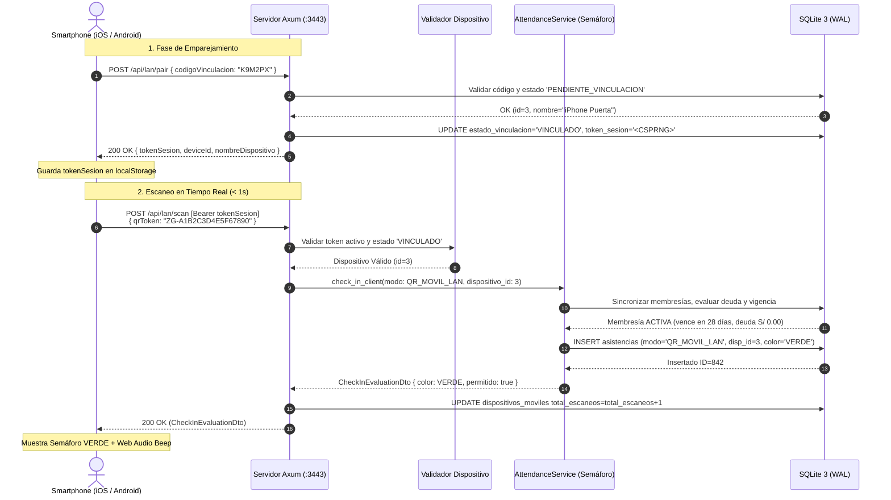

# 📋 CONTRATO TÉCNICO EJECUTABLE: SLICE 6
**Servidor Wi-Fi Local (Axum HTTPS :3443 + mDNS) y Escáner Móvil (iOS / Android)**

---

## 1. Contexto, Objetivos & Arquitectura de Red Local

El **Slice 6** extiende las capacidades operativas de **ZaramaGYM** al entorno móvil sin requerir conectividad a Internet, servidores en la nube ni infraestructura externa. Permite transformar cualquier smartphone moderno (**iPhone con iOS** o **teléfono Android**) conectado a la misma red Wi-Fi local (LAN) en un escáner óptico de credenciales QR de alta velocidad, comunicándose directamente con la aplicación de escritorio principal en el puerto `:3443`.

```
┌─────────────────────────────────────────────────────────────────────────────┐
│                       RED WI-FI LOCAL DEL GIMNASIO (LAN)                    │
│                                                                             │
│   ┌────────────────────────┐                    ┌───────────────────────┐   │
│   │   Smartphone iOS       │                    │   Smartphone Android  │   │
│   │   (Cámara Escáner QR)  │                    │   (Cámara Escáner QR) │   │
│   └───────────┬────────────┘                    └───────────┬───────────┘   │
│               │ HTTPS :3443                                 │ HTTPS :3443   │
│               │ (Bearer Token CSPRNG)                       │               │
│               └──────────────────────┬──────────────────────┘               │
│                                      │                                      │
│                                      ▼                                      │
│               ┌──────────────────────────────────────────────┐              │
│               │ PC PRINCIPAL RECEPCIÓN (Tauri v2 Desktop)    │              │
│               │ ├─ Axum HTTPS Listener (:3443)               │              │
│               │ ├─ TLS Puro con rcgen (Sin OpenSSL nativo)   │              │
│               │ ├─ Anuncio mDNS (sistema.local:3443)         │              │
│               │ ├─ SQLite 3 (WAL) - Tabla asistencias        │              │
│               │ └─ Semáforo Inteligente (< 1s Latencia)      │              │
│               └──────────────────────────────────────────────┘              │
└─────────────────────────────────────────────────────────────────────────────┘
```

### Principios Rectores de Arquitectura:
1. **Independencia Total de la Nube (Local-First Puro):**
   - El gimnasio opera en una red Wi-Fi local estándar (incluso sin salida a Internet / WAN). Los dispositivos móviles se conectan a la IP privada de la PC (ej. `https://192.168.1.45:3443`) o mediante el nombre mDNS `https://sistema.local:3443`.
2. **Criptografía TLS 100% Rust Puro (`rcgen` + `rustls`):**
   - Para acceder a la cámara del smartphone (`navigator.mediaDevices.getUserMedia`), los navegadores móviles modernos (Safari iOS y Chrome/Edge Android) exigen obligatoriamente un contexto seguro (`HTTPS` o `localhost`).
   - El backend genera de forma autónoma una Autoridad Certificadora (CA) raíz local y un certificado de servidor X.509 utilizando la biblioteca pura Rust `rcgen` y `rustls`, evitando cualquier dependencia externa de compilación en Windows como OpenSSL o CMake.
   - El certificado emitido incorpora como Nombres Alternativos del Sujeto (SANs): `localhost`, `127.0.0.1`, las IPs locales detectadas (ej. `192.168.1.X`) y el hostname mDNS `sistema.local`.
   - Se provee el endpoint `GET /api/lan/ca.pem` para descargar e instalar el perfil/certificado raíz en iOS y Android con 1 solo toque, o acceder aceptando la excepción de seguridad local.
   - Para entornos de prueba rápida o navegadores en desarrollo, se mantiene compatibilidad o fallback HTTP en puerto complementario (`:3480`) configurable.
3. **Emparejamiento Seguro de 2 Fases (Código de 6 Caracteres -> Bearer Token 32 HEX):**
   - Ningún dispositivo móvil no autorizado puede interactuar con el sistema.
   - *Fase 1 (Pre-autorización Desktop):* El administrador genera en la PC un emparejamiento con nombre descriptivo (ej. "iPhone Recepción Puerta 2"). El sistema produce un código de emparejamiento de 6 caracteres alfanuméricos en mayúsculas (ej. `ZG-8472` o `K9M2PX`) y un código QR que encapsula la URL directa `https://<ip-lan>:3443/scanner?pair=K9M2PX`.
   - *Fase 2 (Canje Móvil):* Al escanear el QR o tipear el código en el celular, el endpoint `POST /api/lan/pair` valida el código, asocia el `User-Agent` y la IP local del teléfono, y emite un `token_sesion` CSPRNG criptográficamente seguro de 32 caracteres hexadecimales que se almacena en el `localStorage` del navegador móvil.
4. **Revocación Instantánea & Zero-Delete:**
   - En cualquier momento el Administrador o Supervisor puede presionar "Revocar Dispositivo" en la aplicación Desktop.
   - El estado pasa a `REVOCADO`, `estado_activo = 0` y el `token_sesion` queda invalidado de inmediato en memoria y base de datos, bloqueando instantáneamente cualquier intento subsiguiente de escaneo desde dicho teléfono.
5. **Evaluación Semafórica en Tiempo Real ($< 1\text{s}$) e Integración con Slice 5:**
   - Cuando el teléfono vinculado escanea un código QR (`ZG-<16 HEX>`) o envía un documento por fallback manual, el backend invoca el motor de evaluación semafórica existente (`attendance_service::check_in_client`), asignando:
     - `modo_ingreso = 'QR_MOVIL_LAN'`
     - `dispositivo_id = Some(dispositivo.id)`
   - La respuesta semafórica (VERDE, AMARILLO, ROJO) regresa al teléfono en menos de un segundo, disparando la animación a pantalla completa y el feedback sonoro sintetizado con Web Audio API.
6. **Política "CERO Ruido" en Auditoría:**
   - Los escaneos rutinarios no generan registros en `auditoria_logs` (quedan registrados en la tabla operacional `asistencias`).
   - Solo se auditan mutaciones de seguridad del servidor y dispositivos: `CREAR_VINCULACION_MOVIL`, `VINCULAR_DISPOSITIVO_MOVIL`, `REVOCAR_DISPOSITIVO_MOVIL` y `CAMBIAR_ESTADO_SERVIDOR_LAN`, con cargas útiles JSON menores a 200 bytes.

---

## 2. Esquema DDL de `src-tauri/migrations/006_lan_mobile_devices.sql`

```sql
-- ============================================================================
-- MIGRACIÓN 006: SERVIDOR WI-FI LOCAL Y DISPOSITIVOS MÓVILES VINCULADOS
-- Motor: SQLite 3 (WAL Mode, Zero-Delete, Integridad Referencial Estricta)
-- ============================================================================

PRAGMA foreign_keys = ON;

-- 1. TABLA: DISPOSITIVOS_MOVILES (Teléfonos iOS / Android emparejados para escaneo LAN)
CREATE TABLE IF NOT EXISTS dispositivos_moviles (
    id                          INTEGER PRIMARY KEY AUTOINCREMENT,
    nombre_dispositivo          TEXT NOT NULL,
    codigo_vinculacion          TEXT NOT NULL UNIQUE,
    token_sesion                TEXT UNIQUE,
    estado_vinculacion          TEXT NOT NULL DEFAULT 'PENDIENTE_VINCULACION' CHECK(estado_vinculacion IN (
        'PENDIENTE_VINCULACION',
        'VINCULADO',
        'REVOCADO'
    )),
    ip_ultima_conexion          TEXT,
    user_agent                  TEXT,
    ultimo_acceso_at            TEXT,
    total_escaneos              INTEGER NOT NULL DEFAULT 0 CHECK(total_escaneos >= 0),
    creado_por_usuario_id       INTEGER NOT NULL REFERENCES usuarios_sistema(id) ON DELETE RESTRICT,
    revocado_por_usuario_id     INTEGER REFERENCES usuarios_sistema(id) ON DELETE RESTRICT,
    revocado_at                 TEXT,
    estado_activo               INTEGER NOT NULL DEFAULT 1 CHECK(estado_activo IN (0, 1)),
    created_at                  TEXT NOT NULL DEFAULT (datetime('now', 'localtime'))
);

CREATE UNIQUE INDEX IF NOT EXISTS idx_disp_codigo ON dispositivos_moviles(codigo_vinculacion);
CREATE UNIQUE INDEX IF NOT EXISTS idx_disp_token ON dispositivos_moviles(token_sesion);
CREATE INDEX IF NOT EXISTS idx_disp_estado ON dispositivos_moviles(estado_vinculacion, estado_activo);
CREATE INDEX IF NOT EXISTS idx_disp_creado_por ON dispositivos_moviles(creado_por_usuario_id);

-- 2. EXTENSIÓN DE ASISTENCIAS: VINCULACIÓN AL DISPOSITIVO ESCÁNER MÓVIL
-- Permite rastrear qué teléfono móvil específico registró cada asistencia LAN
ALTER TABLE asistencias ADD COLUMN dispositivo_id INTEGER REFERENCES dispositivos_moviles(id) ON DELETE RESTRICT;

CREATE INDEX IF NOT EXISTS idx_asistencias_dispositivo ON asistencias(dispositivo_id);

-- 3. SEED DE CONFIGURACIÓN DEL SERVIDOR LAN EN CONFIGURACION_SISTEMA
INSERT OR IGNORE INTO configuracion_sistema (clave, valor, descripcion)
VALUES
    ('LAN_SERVER_PORT', '3443', 'Puerto TCP para el servidor Wi-Fi local de escáneres móviles'),
    ('LAN_MDNS_HOSTNAME', 'sistema.local', 'Nombre de host mDNS anunciado en la red Wi-Fi local'),
    ('LAN_SERVER_ENABLED', '1', 'Estado habilitado por defecto del servidor LAN al iniciar');
```

### Diccionario de Datos Formal:

| Tabla | Columna | Tipo SQLite | Restricciones / Índices | Nulabilidad | Descripción |
| :--- | :--- | :--- | :--- | :--- | :--- |
| `dispositivos_moviles` | `id` | `INTEGER` | `PRIMARY KEY AUTOINCREMENT` | `NOT NULL` | Identificador único del dispositivo móvil. |
| `dispositivos_moviles` | `nombre_dispositivo` | `TEXT` | `NOT NULL` | `NOT NULL` | Etiqueta humana dada al dispositivo (ej. "iPhone Mostrador 1"). |
| `dispositivos_moviles` | `codigo_vinculacion` | `TEXT` | `UNIQUE`, `idx_disp_codigo` | `NOT NULL` | Código de 6 caracteres alfanuméricos para el emparejamiento. |
| `dispositivos_moviles` | `token_sesion` | `TEXT` | `UNIQUE`, `idx_disp_token` | `NULL` | Token Bearer CSPRNG (32 hex) emitido tras completar el emparejamiento. |
| `dispositivos_moviles` | `estado_vinculacion` | `TEXT` | `CHECK('PENDIENTE_VINCULACION', 'VINCULADO', 'REVOCADO')` | `NOT NULL` | Ciclo de vida de la vinculación del dispositivo. |
| `dispositivos_moviles` | `ip_ultima_conexion` | `TEXT` | - | `NULL` | Dirección IP LAN del cliente (ej. `192.168.1.105`). |
| `dispositivos_moviles` | `user_agent` | `TEXT` | - | `NULL` | Cadena identificadora del navegador y SO del smartphone. |
| `dispositivos_moviles` | `ultimo_acceso_at` | `TEXT` | `ISO 8601` | `NULL` | Marca temporal del último escaneo o ping recibido. |
| `dispositivos_moviles` | `total_escaneos` | `INTEGER` | `CHECK(total_escaneos >= 0)`, `DEFAULT 0` | `NOT NULL` | Contador acumulado de códigos QR escaneados por este celular. |
| `dispositivos_moviles` | `creado_por_usuario_id`| `INTEGER` | `FK -> usuarios_sistema(id) ON DELETE RESTRICT` | `NOT NULL` | Usuario que autorizó la creación de la vinculación. |
| `dispositivos_moviles` | `revocado_por_usuario_id`| `INTEGER` | `FK -> usuarios_sistema(id) ON DELETE RESTRICT` | `NULL` | Usuario que revocó el dispositivo (si aplica). |
| `dispositivos_moviles` | `revocado_at` | `TEXT` | `ISO 8601` | `NULL` | Fecha y hora de la revocación. |
| `dispositivos_moviles` | `estado_activo` | `INTEGER` | `CHECK(estado_activo IN (0, 1))`, `DEFAULT 1` | `NOT NULL` | Flag de baja lógica (Zero-Delete). |
| `dispositivos_moviles` | `created_at` | `TEXT` | `DEFAULT datetime('now', 'localtime')` | `NOT NULL` | Fecha de creación del registro. |
| `asistencias` | `dispositivo_id` | `INTEGER` | `FK -> dispositivos_moviles(id) ON DELETE RESTRICT`, `idx_asistencias_dispositivo` | `NULL` | Dispositivo móvil que registró el ingreso (NULL si fue desde la PC). |

---

## 3. Contratos IPC Desktop (Tauri Commands)

Todos los comandos expuestos a React Desktop siguen la convención obligatoria:
- Decoración en Rust: `#[serde(rename_all = "camelCase")]` con `#[serde(alias = "snake_case")]` en los campos de entrada para permitir compatibilidad estricta.
- El Frontend enviará **únicamente** claves en `camelCase` dentro de los payloads JSON para prevenir colisiones de deserialización.

### 3.1. Resumen de Comandos IPC

| Comando IPC Rust | Roles Autorizados | Descripción Operativa |
| :--- | :--- | :--- |
| `get_lan_server_status` | Todos autenticados | Obtiene el estado del servidor Axum, puerto, IPs LAN, mDNS y estadísticas. |
| `toggle_lan_server` | `ADMINISTRADOR`, `SUPERVISOR` | Inicia o detiene el servidor Axum en caliente sin reiniciar la app. |
| `list_mobile_devices` | Todos autenticados | Retorna la lista de dispositivos registrados con filtros opcionales. |
| `create_mobile_device_pairing` | `ADMINISTRADOR`, `SUPERVISOR` | Genera nuevo emparejamiento con código de 6 caracteres y QR de vinculación. |
| `pair_mobile_device` | Público / Móvil / IPC | Canjea el código de 6 caracteres por el Bearer Token persistente. |
| `revoke_mobile_device` | `ADMINISTRADOR`, `SUPERVISOR` | Revoca de forma inmediata un dispositivo, invalidando su token. |
| `mobile_scan_qr` | Móvil (Token) / Simulación IPC | Ejecuta la evaluación semafórica de asistencia invocada desde un dispositivo móvil. |

---

### 3.2. Definiciones de Estructuras DTO (Rust & TypeScript)

#### A. Estado del Servidor LAN (`LanServerStatusDto`)

```rust
#[derive(Debug, Clone, Serialize, Deserialize)]
#[serde(rename_all = "camelCase")]
pub struct LanServerStatusDto {
    pub is_running: bool,
    pub port: u16,
    pub local_ips: Vec<String>,
    pub primary_ip: String,
    pub https_url: String,
    pub http_url: String,
    pub mdns_hostname: String,
    pub mdns_active: bool,
    pub ca_cert_pem: String,
    pub ca_cert_fingerprint_sha256: String,
    pub total_devices_linked: i64,
    pub total_devices_pending: i64,
    pub total_scans_today: i64,
}
```

```typescript
export interface LanServerStatusDto {
  isRunning: boolean;
  port: number;
  localIps: string[];
  primaryIp: string;
  httpsUrl: string;
  httpUrl: string;
  mdnsHostname: string;
  mdnsActive: boolean;
  caCertPem: string;
  caCertFingerprintSha256: string;
  totalDevicesLinked: number;
  totalDevicesPending: number;
  totalScansToday: number;
}
```

---

#### B. Dispositivo Móvil (`MobileDeviceDto` & Filtro)

```rust
#[derive(Debug, Clone, Serialize, Deserialize)]
#[serde(rename_all = "camelCase")]
pub struct MobileDeviceDto {
    pub id: i64,
    pub nombre_dispositivo: String,
    pub codigo_vinculacion: String,
    pub estado_vinculacion: String, // "PENDIENTE_VINCULACION", "VINCULADO", "REVOCADO"
    pub ip_ultima_conexion: Option<String>,
    pub user_agent: Option<String>,
    pub ultimo_acceso_at: Option<String>,
    pub total_escaneos: i64,
    pub creado_por_usuario_id: i64,
    pub creado_por_nombre: String,
    pub revocado_por_usuario_id: Option<i64>,
    pub revocado_por_nombre: Option<String>,
    pub revocado_at: Option<String>,
    pub estado_activo: i64,
    pub created_at: String,
}

#[derive(Debug, Clone, Default, Serialize, Deserialize)]
#[serde(rename_all = "camelCase")]
pub struct MobileDeviceFilter {
    #[serde(alias = "estado_vinculacion")]
    pub estado_vinculacion: Option<String>,
    #[serde(alias = "estado_activo")]
    pub estado_activo: Option<i64>,
    pub busqueda: Option<String>,
}
```

```typescript
export interface MobileDeviceDto {
  id: number;
  nombreDispositivo: string;
  codigoVinculacion: string;
  estadoVinculacion: "PENDIENTE_VINCULACION" | "VINCULADO" | "REVOCADO";
  ipUltimaConexion: string | null;
  userAgent: string | null;
  ultimoAccesoAt: string | null;
  totalEscaneos: number;
  creadoPorUsuarioId: number;
  creadoPorNombre: string;
  revocadoPorUsuarioId: number | null;
  revocadoPorNombre: string | null;
  revocadoAt: string | null;
  estadoActivo: number;
  createdAt: string;
}

export interface MobileDeviceFilter {
  estadoVinculacion?: "PENDIENTE_VINCULACION" | "VINCULADO" | "REVOCADO";
  estadoActivo?: number;
  busqueda?: string;
}
```

---

#### C. Emparejamiento de Dispositivos (`CreateMobileDeviceInput` & `MobileDevicePairingDto`)

```rust
#[derive(Debug, Clone, Serialize, Deserialize)]
#[serde(rename_all = "camelCase")]
pub struct CreateMobileDeviceInput {
    #[serde(alias = "nombre_dispositivo")]
    pub nombre_dispositivo: String,
}

#[derive(Debug, Clone, Serialize, Deserialize)]
#[serde(rename_all = "camelCase")]
pub struct MobileDevicePairingDto {
    pub device_id: i64,
    pub nombre_dispositivo: String,
    pub codigo_vinculacion: String, // Ej: "ZG-4821" o "K9M2PX"
    pub pairing_url: String,         // https://192.168.1.45:3443/scanner?pair=K9M2PX
    pub qr_data_url: String,         // Imagen QR base64 en memoria para escaneo rápido
    pub expires_in_minutes: i64,     // 60 minutos o permanente hasta vinculación
}

#[derive(Debug, Clone, Serialize, Deserialize)]
#[serde(rename_all = "camelCase")]
pub struct PairMobileDeviceInput {
    #[serde(alias = "codigo_vinculacion")]
    pub codigo_vinculacion: String,
    #[serde(alias = "user_agent")]
    pub user_agent: Option<String>,
    #[serde(alias = "ip_address")]
    pub ip_address: Option<String>,
}

#[derive(Debug, Clone, Serialize, Deserialize)]
#[serde(rename_all = "camelCase")]
pub struct PairedMobileSessionDto {
    pub token_sesion: String, // Token CSPRNG 32 hex
    pub device_id: i64,
    pub nombre_dispositivo: String,
    pub gym_name: String,
}
```

```typescript
export interface CreateMobileDeviceInput {
  nombreDispositivo: string;
}

export interface MobileDevicePairingDto {
  deviceId: number;
  nombreDispositivo: string;
  codigoVinculacion: string;
  pairingUrl: string;
  qrDataUrl: string;
  expiresInMinutes: number;
}

export interface PairMobileDeviceInput {
  codigoVinculacion: string;
  userAgent?: string;
  ipAddress?: string;
}

export interface PairedMobileSessionDto {
  tokenSesion: string;
  deviceId: number;
  nombreDispositivo: string;
  gymName: string;
}
```

---

#### D. Escaneo Móvil de Asistencia (`MobileScanInput` & `CheckInEvaluationDto`)

```rust
#[derive(Debug, Clone, Serialize, Deserialize)]
#[serde(rename_all = "camelCase")]
pub struct MobileScanInput {
    #[serde(alias = "token_sesion")]
    pub token_sesion: String,
    #[serde(alias = "qr_token")]
    pub qr_token: Option<String>,
    #[serde(alias = "numero_documento")]
    pub numero_documento: Option<String>,
}
```

```typescript
export interface MobileScanInput {
  tokenSesion: string;
  qrToken?: string;
  numeroDocumento?: string;
}
```

> [!NOTE]
> El resultado devuelto por `mobile_scan_qr` es el mismo tipo `CheckInEvaluationDto` consolidado en el Slice 5 (`asistencia_id`, `color_semaforo`, `motivo_semaforo`, `nombre_completo`, `dias_restantes`, `deuda_total_pendiente`, `modo_ingreso: AttendanceCheckInMode::QrMovilLan`), garantizando total coherencia en todo el sistema.

---

## 4. Endpoints HTTP / HTTPS del Servidor LAN `Axum` (`:3443`)

El servidor embebido `Axum` se ejecuta en un hilo asíncrono Tokio dentro del proceso Tauri Desktop. Expone los siguientes endpoints REST accesibles desde los navegadores de smartphones en la LAN:



---

### 4.1. Catálogo de Endpoints HTTP

#### 1. `GET /` y `GET /scanner`
- **Propósito:** Entrega la Web App Móvil PWA/SPA (HTML5, Tailwind embebido/CSS limpio, Vanilla JS o bundle precompilado) con las dos vistas móviles:
  - **M1:** Pantalla de Vinculación por Código.
  - **M2:** Visor de Cámara con lector QR (`html5-qrcode` / `jsQR`) y Semáforo a Pantalla Completa.
- **Autenticación:** Pública.

#### 2. `GET /api/lan/ping`
- **Propósito:** Healthcheck sin autenticación para verificar conectividad Wi-Fi desde el móvil o scripts de diagnóstico.
- **Respuesta (200 OK):**
```json
{
  "status": "ok",
  "gym": "ZaramaGYM",
  "hostname": "sistema.local",
  "port": 3443,
  "serverTime": "2026-11-15T18:45:00"
}
```

#### 3. `GET /api/lan/ca.pem`
- **Propósito:** Descarga directa del certificado raíz local autogenerado para instalación de confianza en iOS (`Ajustes > Perfiles descargados > Confiar en certificados raíz`) o Android (`Ajustes > Seguridad > Certificados de usuario CA`).
- **Headers:** `Content-Type: application/x-x509-ca-cert`, `Content-Disposition: attachment; filename="zaramagym-root-ca.crt"`.

#### 4. `POST /api/lan/pair`
- **Propósito:** Empareja el smartphone intercambiando el código de 6 caracteres por el Bearer Token permanente.
- **Payload Request:**
```json
{
  "codigoVinculacion": "K9M2PX",
  "userAgent": "Mozilla/5.0 (iPhone; CPU iPhone OS 17_4 like Mac OS X)..."
}
```
- **Respuesta Éxito (200 OK):**
```json
{
  "tokenSesion": "e4f8a19b2c3d4e5f6a7b8c9d0e1f2a3b",
  "deviceId": 2,
  "nombreDispositivo": "iPhone Recepción",
  "gymName": "ZaramaGYM"
}
```
- **Errores:**
  - `400 Bad Request`: Código inválido, malformado o no proporcionado.
  - `404 Not Found`: Código no encontrado o expirado.
  - `409 Conflict`: El dispositivo ya se encuentra vinculado o revocado.

#### 5. `POST /api/lan/scan`
- **Propósito:** Procesa la lectura de un código QR o ingreso manual de documento desde el móvil.
- **Headers:** `Authorization: Bearer <token_sesion>` (opcionalmente aceptado en el body como `tokenSesion`).
- **Payload Request:**
```json
{
  "qrToken": "ZG-4A82F109C2E348B1",
  "numeroDocumento": null
}
```
- **Respuesta Éxito (200 OK) - Latencia $< 1\text{s}$:**
```json
{
  "asistenciaId": 512,
  "clienteId": 14,
  "nombreCompleto": "Carlos Rodríguez Mendoza",
  "tipoDocumento": "DNI",
  "numeroDocumento": "72849103",
  "fotoPerfilDataUrl": null,
  "colorSemaforo": "VERDE",
  "ingresoPermitido": true,
  "alertaSonora": false,
  "esRebote": false,
  "motivoSemaforo": "Membresía activa vigente",
  "membresiaId": 32,
  "nombrePlan": "Plan Mensual Full",
  "fechaVencimiento": "2026-12-10 23:59:59",
  "diasRestantes": 25,
  "deudaTotalPendiente": "0.00",
  "modoIngreso": "QR_MOVIL_LAN",
  "fechaHoraIngreso": "2026-11-15 18:45:12",
  "creditoGeneradoId": null
}
```
- **Errores:**
  - `401 Unauthorized`: Token de sesión ausente, inválido o perteneciente a un dispositivo revocado (`REVOCADO`).
  - `404 Not Found`: Cliente no localizado con el token QR o número de documento suministrado.
  - `422 Unprocessable Entity`: Cliente inactivo (`estado_activo = 0`).

---

## 5. Reglas de Auditoría Sin Ruido (`auditoria_logs`)

Para mantener la base de datos ágil y los respaldos ligeros conforme a la directiva Zero-Noise, se aplican las siguientes reglas:

1. **Eventos Estrictamente Auditados:**
   - `CREAR_VINCULACION_MOVIL`: Disparado al registrar un nuevo dispositivo pendiente (`device_id`, `nombre_dispositivo`, `codigo_vinculacion`).
   - `VINCULAR_DISPOSITIVO_MOVIL`: Disparado cuando el móvil canjea el código (`device_id`, `ip_address`, `user_agent`).
   - `REVOCAR_DISPOSITIVO_MOVIL`: Disparado al revocar un celular (`device_id`, `motivo`).
   - `CAMBIAR_ESTADO_SERVIDOR_LAN`: Disparado al activar o desactivar el servidor Axum (`running: bool`, `port: u16`).
2. **Límite de Carga:** El campo `detalles_json` no debe superar los 200 bytes por evento.
3. **Prohibiciones Absolutas:**
   - 🚫 Prohibido auditar `ping`, descargas de `ca.pem`, cargas de la página `/scanner` o consultas de estado `get_lan_server_status`.
   - 🚫 Prohibido auditar escaneos rutinarios de asistencias en `auditoria_logs` (las asistencias quedan asentadas en su propia tabla con `dispositivo_id` y `modo_ingreso = 'QR_MOVIL_LAN'`).

---

## 6. Especificación de Vistas Frontend (Desktop y Móvil M1/M2)

### 6.1. Vista Desktop: Panel Servidor LAN y Dispositivos Vinculados

Ubicado en el menú principal bajo el módulo **"Servidor Wi-Fi y Escáner Móvil"**:

```
┌─────────────────────────────────────────────────────────────────────────────┐
│  📡 Servidor Wi-Fi Local & Escáner Móvil                          [?] Ayuda │
├─────────────────────────────────────────────────────────────────────────────┤
│  ESTADO DEL SERVIDOR LOCAL: [ 🟢 EN LÍNEA ]           [ Detener Servidor ]   │
│  IP Local: 192.168.1.45   │ Puerto: 3443   │ Host mDNS: sistema.local:3443  │
│  URL Móvil: https://192.168.1.45:3443/scanner           [ 📋 Copiar URL ]    │
│  Certificado CA: [ 📥 Descargar ca.pem ]  │ Huella: SHA256: 7F4A...B902     │
├─────────────────────────────────────────────────────────────────────────────┤
│  ➕ VINCULAR NUEVO DISPOSITIVO MÓVIL                                        │
│  Nombre: [ iPhone Entrada Principal      ]  [ Generar Código de Enlace ]    │
│                                                                             │
│  ┌────────────────────────┐   Código Manual: [ ZG - 8 4 7 2 ]               │
│  │    ██████████████      │   Escanea este código QR con la cámara de tu    │
│  │    ██  ████  ████      │   iPhone o Android conectado al Wi-Fi del gym.  │
│  │    ██████████████      │   Válido por 60 minutos.                        │
│  └────────────────────────┘                                                 │
├─────────────────────────────────────────────────────────────────────────────┤
│  📱 DISPOSITIVOS MÓVILES REGISTRADOS                                        │
│  ┌───────────────────────┬────────────┬─────────────┬──────────┬──────────┐ │
│  │ Dispositivo           │ Estado     │ IP / Conex. │ Escaneos │ Acciones │ │
│  ├───────────────────────┼────────────┼─────────────┼──────────┼──────────┤ │
│  │ Galaxy S22 Portería   │ VINCULADO  │ 192.168.1.60│ 142 hoy  │ [Revocar]│ │
│  │ iPhone 13 Recepción   │ VINCULADO  │ 192.168.1.72│ 89 hoy   │ [Revocar]│ │
│  │ Tablet Molinete (P)   │ PENDIENTE  │ -           │ 0        │ [Revocar]│ │
│  │ Celular Juan (Antiguo)│ REVOCADO   │ 192.168.1.99│ 320 tot. │ [Elimin.]│ │
│  └───────────────────────┴────────────┴─────────────┴──────────┴──────────┘ │
├─────────────────────────────────────────────────────────────────────────────┤
│  🔬 [ Simular Vista Móvil en Pantalla (M1 / M2) ]                            │
└─────────────────────────────────────────────────────────────────────────────┘
```

---

### 6.2. Vista Móvil M1: Pantalla de Vinculación (`/scanner`)

Se presenta automáticamente si no existe un `token_sesion` válido en el dispositivo:
- Encabezado con logotipo e identidad **ZaramaGYM**.
- Caja de entrada para el **Código de Vinculación (6 Caracteres)** con formateo automático en mayúsculas y soporte para rellenado automático si la URL incluye `?pair=XXXXXX`.
- Botón principal de acción: `[ 🔗 Vincular este Teléfono ]`.
- Alerta amigable indicando la necesidad de estar conectado a la red Wi-Fi local del gimnasio.
- Enlace directo: *"¿Problemas de seguridad SSL? Descargar certificado raíz del gym"*.

---

### 6.3. Vista Móvil M2: Cámara Escáner QR & Semáforo a Pantalla Completa

Una vez vinculado el teléfono:
- **Header Compacto:** Nombre del dispositivo (ej. *"iPhone Entrada"*), indicador de estado de conexión LAN (punto verde) y botón discreto para desvincular.
- **Visor de Cámara Central:** Utiliza la cámara trasera principal (`facingMode: "environment"`). Enmarca el QR con guías de escaneo visuales.
- **Botón Flotante:** `[ ⌨️ Ingreso Manual por DNI ]` para emergencias de lectura.
- **Overlay Semafórico Reactivo a Pantalla Completa ($< 1\text{s}$):**
  - 🟢 **VERDE (Acceso Concedido):**
    - Fondo verde esmeralda brillante (`bg-emerald-600`), icono de check gigante.
    - Nombre del socio, nombre del plan y días restantes (ej. *"¡Pasa adelante! Quedan 24 días"*).
    - Tono sintetizado Web Audio de 880 Hz (0.15s).
    - Retorno automático a la cámara en **2.5 segundos** sin intervención manual.
  - 🟡 **AMARILLO (Alerta Preventiva):**
    - Fondo ámbar vibrante (`bg-amber-500`), icono de advertencia.
    - Nombre del socio y detalle de la alerta (ej. *"¡Vence en 2 días!"* o *"Saldo pendiente: S/ 30.00"*).
    - Doble tono sintetizado Web Audio (660 Hz + 880 Hz).
    - Retorno automático en **3.5 segundos** o botón `[ Continuar ]`.
  - 🔴 **ROJO (Acceso Bloqueado):**
    - Fondo carmesí (`bg-red-600`), icono gigante de prohibido/alto.
    - Nombre del socio y motivo del bloqueo en texto grande (ej. *"Membresía vencida el 10/11/2026"*).
    - Mensaje destacado: **"POR FAVOR DIRÍJASE A CAJA"**.
    - Tono grave Web Audio de 220 Hz (0.35s).
    - Permanece en pantalla hasta que el operador presione `[ Cerrar y Escanear Siguiente ]`.

---

## 7. Matriz de Verificación QA (Casos de Prueba CP-LAN-01 a CP-LAN-10)

| Código | Escenario de Prueba | Entrada / Acción | Resultado Esperado |
| :--- | :--- | :--- | :--- |
| **CP-LAN-01** | Inicio y parada del Servidor LAN Axum | Invocar `toggle_lan_server(true)` y `toggle_lan_server(false)` | El servidor abre el listener TCP en el puerto `:3443`, reporta URLs activas y se detiene limpiamente. |
| **CP-LAN-02** | Healthcheck ping público | `GET /api/lan/ping` sin credenciales | Devuelve `200 OK` con JSON `{ status: "ok", gym: "ZaramaGYM" }`. |
| **CP-LAN-03** | Descarga del certificado CA raíz | `GET /api/lan/ca.pem` | Devuelve `200 OK`, cabecera `application/x-x509-ca-cert` y contenido PEM válido. |
| **CP-LAN-04** | Creación de emparejamiento desde Desktop | `create_mobile_device_pairing("iPhone Puerta")` | Genera registro `PENDIENTE_VINCULACION`, código de 6 caracteres único y QR URL. Audita `CREAR_VINCULACION_MOVIL`. |
| **CP-LAN-05** | Canje de código por Token de Sesión Móvil | `POST /api/lan/pair` con código correcto | Cambia estado a `VINCULADO`, emite token CSPRNG de 32 hex y audita `VINCULAR_DISPOSITIVO_MOVIL`. |
| **CP-LAN-06** | Canje de código inválido o reutilizado | `POST /api/lan/pair` con código erróneo o ya vinculado | Retorna error `400 Bad Request` o `409 Conflict` sin emitir token. |
| **CP-LAN-07** | Escaneo QR móvil Semáforo VERDE | `POST /api/lan/scan` con token de socio al día | Responde en $< 1\text{s}$ con `colorSemaforo: "VERDE"`, inserta asistencia con `dispositivo_id` e incrementa contador de escaneos. |
| **CP-LAN-08** | Escaneo QR móvil Semáforo AMARILLO | `POST /api/lan/scan` con socio con deuda o vencimiento $\le 5$ días | Responde en $< 1\text{s}$ con `colorSemaforo: "AMARILLO"`, alerta sonora `true` y detalle del motivo. |
| **CP-LAN-09** | Escaneo QR móvil Semáforo ROJO | `POST /api/lan/scan` con socio con membresía vencida | Responde con `colorSemaforo: "ROJO"`, `ingresoPermitido: false`, no inserta asistencia prematura. |
| **CP-LAN-10** | Revocación inmediata de dispositivo | `revoke_mobile_device(device_id)` | El estado pasa a `REVOCADO`, `estado_activo = 0`. Peticiones subsiguientes a `/api/lan/scan` con ese token son rechazadas con `401 Unauthorized`. |
